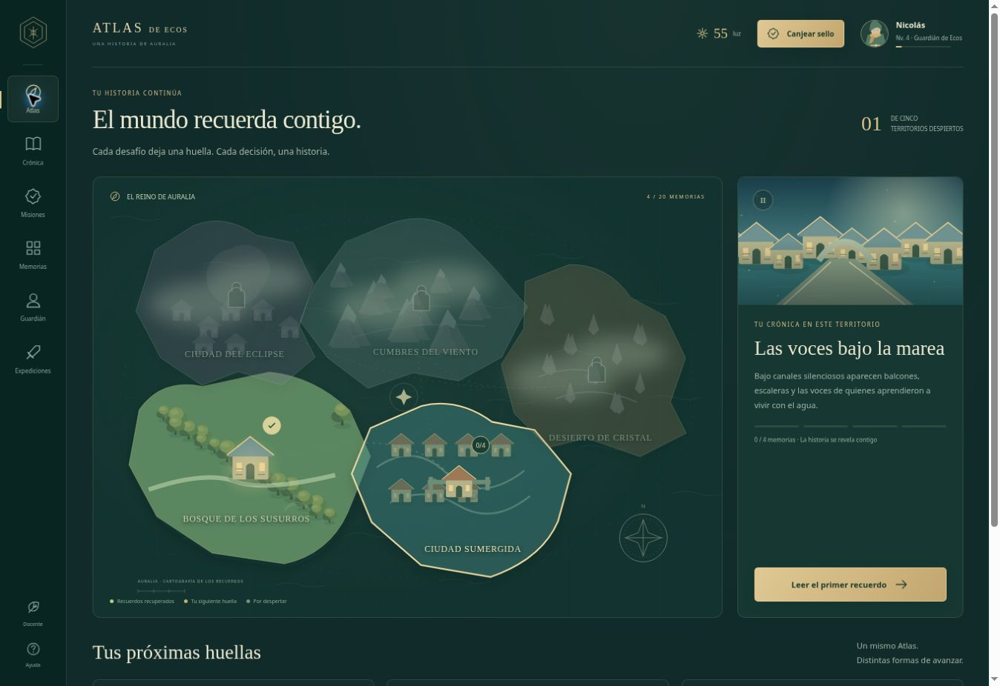

# Ecos de Auralia · Atlas de Ecos

**Prototipo 0.2 · Un núcleo narrativo y expediciones conectadas.**



Ecos de Auralia tiene dos experiencias complementarias:

| Experiencia | Función | Ruta |
| --- | --- | --- |
| **Atlas de Ecos** | Centro persistente de gamificación, recompensas, colección e historia | `/` |
| **El primer recuerdo** | Prototipo de exploración cenital, acertijos y combate | `/expedicion/` |

- [Abrir el Atlas](https://ecos-de-auralia.nico-ergo.chatgpt.site)
- [Abrir la expedición](https://ecos-de-auralia.nico-ergo.chatgpt.site/expedicion/)

El enlace de revisión es personal y requiere la sesión de ChatGPT del propietario. El repositorio contiene el código estático completo.

## El núcleo de gamificación

- Cinco territorios que recuperan color con el avance.
- Veinte actividades y veinte memorias coleccionables.
- Cinco capítulos de aventura gráfica, con tres escenas cada uno.
- Dos futuros por capítulo: las decisiones modifican los hitos del mapa y quedan registradas en la crónica.
- Experiencia, ocho niveles y tres formas de un compañero de luz.
- Luz para obtener acabados cosméticos del Atlas; las compras no son necesarias para completar la historia.
- Cinco reliquias asociadas a los territorios; los hallazgos de la expedición también se registran.
- Nombre y apariencia del guardián, guardado automático y exportación/importación de la copia local.
- Guía docente con códigos, consignas editables y accesos de demostración.

**Una actividad → un código → una memoria + experiencia + luz. Dos memorias → una decisión. Cuatro memorias + una decisión → territorio restaurado y acceso al siguiente.**

Los códigos pueden usarse en cualquier orden dentro de un territorio abierto. Cada recompensa se registra una sola vez.

## Revisar la idea rápidamente

1. Abre **Guía docente y códigos de prueba** desde el Atlas, o **Docente** en la barra lateral.
2. Pulsa **Probar una recompensa** para observar una memoria y sus premios.
3. Pulsa **Preparar una decisión y su desenlace** para reunir las actividades del territorio actual.
4. Elige el futuro del lugar en su crónica. El mapa cambia y se abre el siguiente territorio.
5. Revisa **Memorias**, **Guardián** y **La forja del Atlas**.
6. En **Expediciones**, entra a la aventura original. Regresa mediante **CENTRO / Volver al Atlas**.

Los accesos rápidos modifican la partida local de revisión. El menú de ayuda permite exportar una copia o reiniciar el Atlas. Reiniciarlo no borra la expedición y sus hallazgos vuelven a importarse.

## Puente con la exploración

La aventura original conserva su código, sus controles y su guardado. El Atlas lee únicamente sus hallazgos al abrirse o recuperar el foco, sin modificar esa partida:

| Hallazgo en la expedición | Efecto en el Atlas |
| --- | --- |
| Conseguir el Guante de Raíces | Registra la reliquia, +20 experiencia y +10 luz |
| Recuperar el Eco del Bosque | Completa `bosque-3`, +70 experiencia, +22 luz y una memoria |
| Encontrar la semilla de Valdeluz | Registra el secreto, +20 experiencia y +8 luz |

Si una actividad ya se completó con un código, la expedición no vuelve a premiarla. El puente funciona en el mismo navegador y origen. Las habilidades del juego cenital se siguen obteniendo dentro de esa expedición; las decisiones del Atlas no reescriben ese primer prototipo.

## Alcance y datos

Este es un prototipo local. Los códigos son públicos y no autentican personas ni verifican evaluaciones. No hay cuentas de estudiantes, calificaciones, Google Sheets ni seguimiento remoto compartido. La guía docente edita las consignas de esta copia; no es un panel institucional protegido.

| Dato | Clave local |
| --- | --- |
| Atlas y consignas | `auralia.atlas.v1` |
| Partida de exploración | `auralia.adventure.v1` |

La exportación del Atlas incluye su progreso, decisiones, personalización y consignas. La partida de la expedición tiene su propio guardado y no está incluida en ese archivo.

Los cinco territorios tienen misiones, recompensas y crónica en el Atlas. Solo el bosque tiene un mundo de exploración cenital implementado. Los otros encuentros quedan para una siguiente etapa.

## Código

| Archivo | Función |
| --- | --- |
| `dist/index.html`, `atlas.css`, `atlas.js` | Interfaz del núcleo y navegación |
| `dist/atlas-data.js` | Territorios, veinte misiones, capítulos, decisiones, códigos y recompensas |
| `dist/atlas-core.js` | Progresión, decisiones, economía, copia de seguridad e importación de expediciones |
| `dist/atlas-art.js` | Mapa, escenas y guardián en SVG original |
| `dist/expedicion/index.html` | Entrada separada a la exploración |
| `dist/game.js`, `engine.js`, `art.js`, `audio.js`, `game-data.js` | Motor original de la expedición |
| `docs/ATLAS.md` | Modelo narrativo y guía de integración |
| `docs/PROPUESTA.md` | Propuesta original del primer prototipo cenital |
| `tests/atlas.test.mjs`, `tests/progression.test.mjs` | Reglas del Atlas y regresión de la expedición |

No requiere dependencias ni compilación. Los escenarios son SVG/Canvas originales y el sonido de la expedición se sintetiza en el navegador.

```sh
python3 -m http.server 8000 --directory dist
npm run check
npm test
```

Abrir `http://localhost:8000`. Los módulos requieren servir los archivos por HTTP. El HTML de la raíz redirige a `dist/`; la publicación de Sites está declarada en `.openai/hosting.json`.
