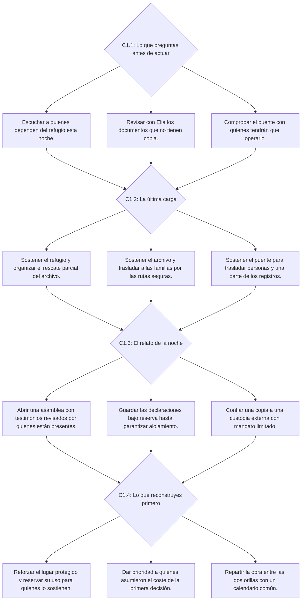
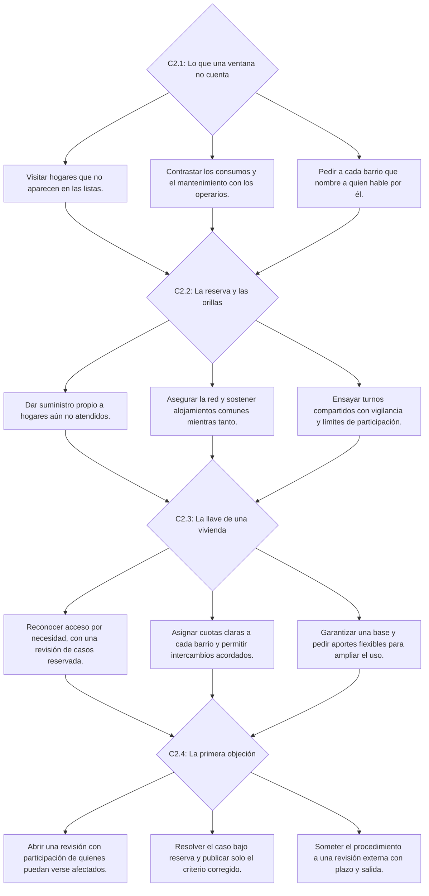
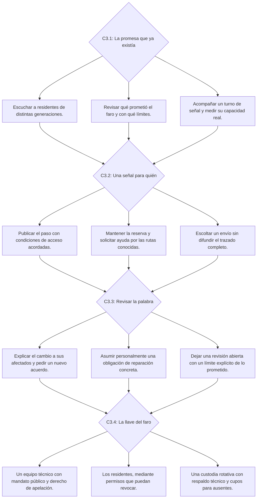
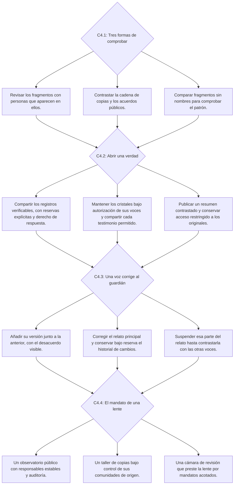
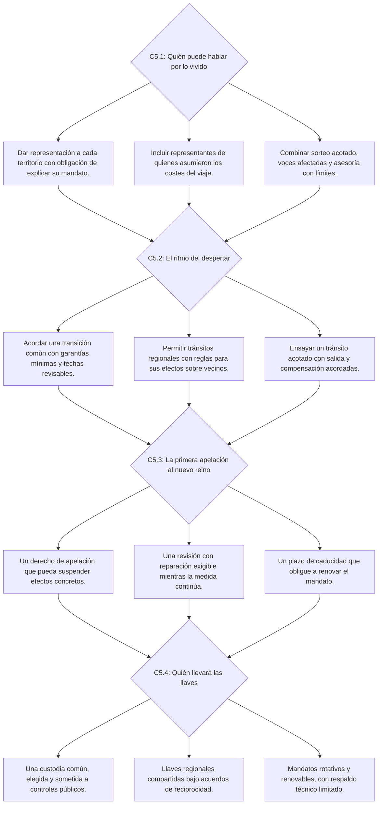

# Atlas de Ecos: las voces del Velo
## Biblia narrativa y árbol de consecuencias
Versión 1.0 · 4 de noviembre de 2026 · Diseño para revisión, previo a construcción.

## 01 / Contrato de diseño

### Propósito
Construir una novela gráfica personal conectada a recompensas del aula. Cada estudiante reúne memorias, toma decisiones contextualizadas y conserva un Atlas diferente por la combinación de hechos, acuerdos, relaciones y pérdidas.

### Estado de esta guía
Propuesta completa de construcción, versión 1.0 del 4 de noviembre de 2026. Sustituye el árbol simple de cinco decisiones binarias de los primeros bocetos. No se ha aplicado al código publicado. Los detalles literarios y el equilibrio de relaciones deberán probarse con lectores.

### Alcance
Cinco capítulos, dos decisiones de prólogo, veinte decisiones ligadas a memorias, sesenta y seis alternativas redactadas, una compuerta contextual reutilizable y tres familias de desenlace. La guía define efectos y rutas; no implica que existan sesenta y seis ilustraciones terminadas ni campañas escritas para todas las combinaciones.

### Límite del proyecto actual
El foco es el Atlas narrativo. Las expediciones cenitales quedan para una etapa posterior. Sus hallazgos podrán alimentar el Atlas mediante identificadores únicos, sin convertir el combate en requisito para avanzar en esta historia.

### Criterio de éxito
Dos personas con las mismas veinte recompensas académicas pueden conservar instituciones, testimonios, compromisos y escenas finales diferentes. Ambas deben poder terminar la campaña; ninguna necesita maximizar una puntuación de virtud.

### Qué se entrega
PDF para lectura y revisión; fuentes editables en Markdown y JSON; diagramas vectoriales y auditoría de estructura. El JSON es una especificación de contenido, no un motor ejecutable ni una conexión de cuentas.

## 02 / El mundo y la verdad que se revela

### Antes del silencio
La Gran Crecida dañó caminos, viviendas y las redes de luz del reino. El Pacto del Velo amortiguó recuerdos ligados al desastre y sostuvo parte de la infraestructura. Algunas comunidades aceptaron un mandato temporal; otras negociaron reservas o no estuvieron representadas.

### Cómo se volvió permanente
La revisión del pacto fue aplazándose. Los archivos conservaron autorizaciones desiguales y el acceso al conocimiento se concentró. Nadie conoce por sí solo toda la historia: existen beneficios reales, pérdidas reales y decisiones defendidas desde experiencias distintas.

### El presente
Auralia pierde conexiones entre sus lugares y las razones por las que sus instituciones existen. El protagonista recibe un Atlas capaz de reunir memorias y mostrar sus relaciones. Su poder consiste en hacer visibles hechos y compromisos; no identifica una verdad moral perfecta.

### La revelación progresiva
C1 descubre una revisión pendiente. C2 muestra exclusiones en los registros y dependencias técnicas. C3 revela que el conocimiento de una ruta modifica la autonomía. C4 reconstruye autorizaciones, objeciones y custodias. C5 permite cambiar el pacto y su gobierno con costes persistentes.

### Tono y límites de escena
Fantasía luminosa, misterio y conflictos sobre memoria, pertenencia y poder. No usar muerte sorpresiva, violencia gráfica o culpa extrema como castigo oculto por una elección. Las pérdidas de documentos, arraigo, privacidad, tiempo y confianza ofrecen consecuencias suficientes.

### Personaje propio
Nombre o apodo, apariencia, emblema y compañero de luz son personalización. El origen puede cambiar líneas de bienvenida sin conceder superioridad moral, privilegios académicos o una ruta con información crítica inaccesible a los demás.

## 03 / Cómo escribir grises sin hacer trampas

### Regla de los seis elementos
Cada alternativa debe contener un motivo defendible, un valor en conflicto, un coste reconocible, un beneficiario, una voz que objete y una consecuencia posterior. Si una opción domina a todas las demás en todos esos aspectos, hay que reescribirla.

### Información honesta, incertidumbre real
El jugador conoce el riesgo básico y lo que cada personaje sabe o cree. Puede ignorar detalles, pero no debe recibir un castigo moral retroactivo por un dato que el juego le ocultó sin señales. Diferenciar hechos comprobados, interpretaciones y promesas.

### Lenguaje del menú
Usar acciones concretas: compartir registros revisados, sostener una reserva o delegar una custodia. Evitar ayudar/ignorar, decir la verdad/mentir por egoísmo, iconos verde/rojo, alineamientos buenos/malos y opciones sarcásticas que delatan la ruta castigada.

### Costes de una tercera vía
Las opciones condicionadas por investigación nunca resuelven todo. Trasladar desplaza arraigo; coordinar exige tiempo; resumir pierde contexto; revisar consume capacidad. La ruta C puede ser adecuada para cierto estado y costosa para otro.

### Personajes con razones y límites
Nara puede valorar una prueba más que una solución inmediata; Elia puede pedir reserva para proteger una voz. Ninguno es portavoz fijo de bondad, egoísmo, ciencia o emoción. Cada cual puede reconocer una objeción sin cambiar mágicamente de opinión.

### Revelación posterior
Una consecuencia debe poder rastrearse a una decisión y a su advertencia. Una nueva prueba puede corregir un relato, no convertir arbitrariamente una opción razonable en maldad. El guion conserva quién sabía qué en cada momento.

## 04 / Honor, confianza y huellas

### Revisión del sistema anterior
Se retira la tabla automática publicar +5 / reservar 0 / mentir -5. Revelar puede vulnerar una reserva; reservar puede cumplir un acuerdo; una revisión pública puede excluir voces ausentes. La moral del personaje se explora mediante relaciones y compromisos.

### Honor: registro de la palabra
El Atlas muestra compromisos concretos: vigente, sostenido, en tensión, renegociado, pendiente o reparado. Un estado no diagnostica al estudiante ni determina el final correcto. En el perfil puede aparecer un resumen narrativo, nunca un ranking de personas buenas.

### Juramento elegido
Amparo, Memoria o Vínculo cambian las preguntas del diario. No otorgan puntos por escoger la misma familia de respuestas. Todos requieren reconocer costes para terceros, incluso cuando la acción coincide con el juramento.

### Confianza por personaje
Referencia interna sugerida: -2 a +2, inicio 0 y saturación en extremos. Los cambios de la ficha solo se aplican si el personaje presenció el hecho o recibió información sobre él. La interfaz muestra reacciones y razones, no recompensas numéricas antes de elegir.

### Huellas independientes
Un archivo perdido no se regenera por una disculpa. Una institución reconstruida no cambia automáticamente la opinión de todos. La imagen del Atlas, la memoria recibida y las futuras opciones deben conservar esos hechos.

### Reparación sin borrado
Reconocer un coste, compensarlo y recuperar confianza son eventos distintos. Una reparación puede quedar incompleta y aun así permitir continuar. Nunca repetir una disculpa o recargar una escena para cultivar honor o experiencia.

## 05 / Ritmo, recompensas y autonomía

### Estructura de cada capítulo
Un prólogo abre el lugar. Memoria 1 habilita investigación; memoria 2, intervención; memoria 3, forma de responder; memoria 4, compromiso e institución de cierre. Las elecciones anteriores condicionan escenas y alternativas, no la posibilidad de terminar la materia.

### Relación con el aula
El docente entrega códigos según actividades definidas. Cada memoria conserva su recompensa de experiencia y luz con independencia de la ruta narrativa. El relato puede pedir revisar razones, pero la elección del personaje no se convierte en una respuesta académica correcta o incorrecta.

### Memorias adelantadas
Los códigos obtenidos pueden registrarse antes de leer las escenas. El relato los usa en orden después de confirmar los nodos anteriores. Ausentarse o tardar en volver no incumple una promesa: sus revisiones se activan por escenas, no por el reloj.

### Equilibrio base
Por territorio: cuatro memorias con 40, 50, 70 y 90 de experiencia; 12, 16, 22 y 30 de luz. Restauración: 50 de experiencia y 25 de luz. Totales del núcleo: 1.500 experiencia y 525 luz. Las decisiones no añaden premios morales ni alteran estos totales.

### Pérdidas narrativas
Pueden cambiar un edificio, un aliado, el acceso a un documento o una institución; no eliminan una recompensa de clase ni bloquean el código siguiente. Un objeto narrativo sacrificado se reemplaza en la colección por una memoria variante del mismo nivel.

### Confirmación
Antes de consolidar se puede releer y volver al menú. Al confirmar, se guarda una decisión única. Si el guardado remoto falla en una futura versión, se conserva el registro pendiente y no se representa una ruta distinta como si ya se hubiera confirmado.

## Mapa maestro

Dos decisiones de prólogo preceden a cinco capítulos. Cada capítulo tiene cuatro memorias y cuatro decisiones en orden. Las ramas vuelven a escenas comunes conservando hechos, compromisos y consecuencias posteriores. C5.4 elige una familia de cierre, que se personaliza con el recorrido.

## Guion del prólogo

### Viñeta 1. El mapa que guarda ausencias
En la plaza de Valdeluz hay un pedestal con cinco marcas. Una ha desaparecido de la memoria de todos, aunque el hueco sigue en la piedra. Cuando acercas la mano, una campana suena debajo del suelo.
**Dirección visual:** Encuadre: plaza amplia, detalle del hueco y reflejo del protagonista sin fijar todavía su apariencia.

### Viñeta 2. Una tableta sin dueño
Elia: «Me dijeron que este Atlas recuerda los caminos». Nara: «Entonces habrá que preguntarle por quienes no pudieron recorrerlos». La pantalla se enciende. No dibuja una ruta: muestra tres preguntas sin respuesta.
**Dirección visual:** Encuadre: manos y tableta. El personaje elegido aparece con su nombre y aspecto; el texto no presupone género.

### Viñeta 3. La promesa limitada
Elia: «Hay cosas que un mapa no debería decidir por nosotros». Nara: «Y hay silencios que también deciden». El Atlas solicita un juramento, con una advertencia: ningún principio hará desaparecer el coste de elegir.
**Dirección visual:** Se habilita P.1. El compañero de luz aparece como testigo, no como juez que aprueba la respuesta.

### Viñeta 4. La primera voz
Una vecina reconoce su propia voz dentro de un cristal. «No recuerdo haber autorizado que la escucharan aquí». Elia señala una fecha antigua; Nara pregunta qué ocurrió con quienes nacieron después.
**Dirección visual:** Se habilita P.2. El conflicto del consentimiento queda anticipado antes de que el jugador tenga que resolverlo en C4.

## Prólogo

### P.1 · La primera inscripción
**Escena:** Elia abre una tableta sin mapa. En el borde se lee: «Elegirás con información incompleta. Este Atlas conservará también lo que no pudiste hacer». Nara pide que escribas qué intentarás proteger cuando dos deberes entren en conflicto.

**Decisión:** ¿Qué principio quieres que guíe a tu guardián?

**Señal previa:** Elia advierte que ningún principio garantiza un resultado sin pérdidas.

#### P.1.A · Dar prioridad a quienes tienen menos margen para esperar.
- Motivo: El auxilio pierde sentido si llega después de una pérdida evitable.
- Coste anticipado: La urgencia puede consumir recursos que sostienen a otras personas mañana.
- Consecuencia inmediata: Se inscribe el juramento de Amparo. No cambia experiencia, dificultad ni premio.
- Consecuencia posterior: En cada cierre, el Atlas pregunta quién recibió protección y a quién se trasladó el coste.
- Hecho guardado: `oath=amparo`
- Condición: Siempre disponible dentro del nodo.
- Honor contextual: Evaluar compromisos vigentes y medios utilizados; la prioridad elegida no otorga honor por sí sola.
- Confianza si se conoce: {}
- Callback: `CB_P.1.A` en `C1.1`.

#### P.1.B · Conservar las pruebas que permitan decidir con conocimiento.
- Motivo: Las comunidades necesitan recordar para discutir sus propias versiones.
- Coste anticipado: Recuperar o divulgar pruebas puede exponer a quienes preferirían reservarlas.
- Consecuencia inmediata: Se inscribe el juramento de Memoria, que incluye el cuidado de testimonios y consentimientos.
- Consecuencia posterior: Los capítulos revisan tanto lo que conservaste como quién pudo decidir sobre su uso.
- Hecho guardado: `oath=memoria`
- Condición: Siempre disponible dentro del nodo.
- Honor contextual: Evaluar compromisos vigentes y medios utilizados; la prioridad elegida no otorga honor por sí sola.
- Confianza si se conoce: {}
- Callback: `CB_P.1.B` en `C1.1`.

#### P.1.C · Sostener acuerdos que las personas puedan aceptar o revisar.
- Motivo: Un resultado estable necesita legitimidad y una salida para quien disiente.
- Coste anticipado: Negociar puede demorar una ayuda urgente y favorecer a quien tiene tiempo o influencia.
- Consecuencia inmediata: Se inscribe el juramento de Vínculo. No es una ruta de diplomacia superior.
- Consecuencia posterior: El Atlas recuerda quién estuvo representado y quién quedó esperando.
- Hecho guardado: `oath=vinculo`
- Condición: Siempre disponible dentro del nodo.
- Honor contextual: Evaluar compromisos vigentes y medios utilizados; la prioridad elegida no otorga honor por sí sola.
- Confianza si se conoce: {}
- Callback: `CB_P.1.C` en `C1.1`.

**Revisión editorial:** El juramento es un compromiso discutible del personaje, no una clase moral ni un modificador de premios. Cambiarlo después exige una escena de revisión y conserva el juramento anterior en el diario.
**Siguiente nodo:** `P.2`.

### P.2 · La regla de las voces
**Escena:** La tableta puede registrar las palabras de otros. Elia teme que una grabación circule sin contexto; Nara recuerda que algunos acuerdos dejaron fuera a quienes no estaban presentes. Debes elegir un protocolo inicial, revisable cuando cambien las circunstancias.

**Decisión:** ¿Cómo custodiarás los testimonios que te confíen?

**Señal previa:** El Atlas explica que ocultar un nombre no garantiza anonimato en una comunidad pequeña.

#### P.2.A · Mostrar a cada persona el registro antes de compartirlo.
- Motivo: Cada voz puede corregir una representación equivocada.
- Coste anticipado: Revisar uno a uno retrasa la circulación de información; las personas ausentes no podrán responder.
- Consecuencia inmediata: Queda un compromiso de revisión individual para testimonios identificables.
- Consecuencia posterior: En el desierto, un testigo ausente pondrá a prueba esta regla.
- Hecho guardado: `testimony=revision_individual`
- Condición: Siempre disponible dentro del nodo.
- Honor contextual: Registrar un compromiso explícito. Cederlo unilateralmente crea tensión; renegociarlo no borra sus costes.
- Confianza si se conoce: {}
- Callback: `CB_P.2.A` en `C1.1`.

#### P.2.B · Conservar un archivo íntegro con acceso acordado por la comunidad.
- Motivo: Una evidencia completa puede impedir que el poder elija qué se recuerda.
- Coste anticipado: Un acuerdo mayoritario puede no proteger a una voz minoritaria.
- Consecuencia inmediata: Se registra una custodia comunitaria con derecho a presentar objeciones.
- Consecuencia posterior: La ciudad pedirá decidir qué cuenta como representación suficiente.
- Hecho guardado: `testimony=custodia_comun`
- Condición: Siempre disponible dentro del nodo.
- Honor contextual: La coherencia exige tramitar objeciones reales, no usar una votación para simular consentimiento.
- Confianza si se conoce: {}
- Callback: `CB_P.2.B` en `C1.1`.

#### P.2.C · Separar los hechos comprobables de los nombres de sus testigos.
- Motivo: La información puede circular sin exponer de inmediato identidades.
- Coste anticipado: Sin nombres, algunas responsabilidades serán difíciles de exigir y las versiones podrán disputarse.
- Consecuencia inmediata: El Atlas conserva dos capas: hechos compartibles y nombres bajo reserva.
- Consecuencia posterior: Una prueba de autoría hará relevante la capa que reservaste.
- Hecho guardado: `testimony=capas_separadas`
- Condición: Siempre disponible dentro del nodo.
- Honor contextual: Preservar una reserva acordada puede sostener el honor aunque disminuya la confianza de quien exige acceso.
- Confianza si se conoce: {}
- Callback: `CB_P.2.C` en `C1.1`.

**Revisión editorial:** Las tres reglas son protocolos incompletos. No cambian todas las escenas por sí solas; añaden compromisos que se activan cuando una decisión usa testimonios.
**Siguiente nodo:** `C1.1`.

## C1 · La noche de las dos luces

**Territorio:** Bosque de los Susurros

**Pregunta ética:** ¿Qué proteges cuando la urgencia de unas personas compite con la continuidad de otras?

**Premisa:** Una tormenta daña dos sellos. Una sola carga puede sostener el refugio, el archivo o el puente de evacuación. Las rutas seguras están identificadas: nadie queda condenado a morir por una elección de menú. Las pérdidas afectan hogares, documentos, vínculos y autonomía.

**Verdad del guion:** El archivo contiene testimonios sobre el Pacto del Velo, un sistema que amortiguó recuerdos dolorosos y sostuvo infraestructuras tras una catástrofe. Su renovación debía consultarse a cada generación. Algunas revisiones se aplazaron y otras no representaron a quienes vivían fuera de Valdeluz.

### Personajes en tensión

- Elia conserva documentos que también podrían cuestionar decisiones de su familia.
- Nara protege a las familias, pero necesita una prueba del archivo para esclarecer por qué la suya salió del pueblo.

### Señales que deben aparecer antes de elegir

- La carga disponible no alcanza para sostener dos sellos.
- El puente solo admite una evacuación ordenada; un cierre inesperado separaría a los grupos.
- Trasladar personas y documentos no conserva intacto el lugar del que se marchan.

### Escenas condicionales después de la intervención

**C1.2=A**
La cocina del refugio vuelve a encenderse. Una vecina reconoce a su nieta, pero no recuerda el nombre de la calle donde nació: el folio que lo conservaba se perdió. Nara reparte mantas y pide que nadie llame a esto una victoria completa. Elia llega con una caja vacía y pregunta qué parte del archivo podrá reconstruirse con las voces que quedan.

**C1.2=B**
El archivo permanece seco. Elia encuentra una autorización del antiguo consejo y deja de leer cuando reconoce una firma familiar. Desde la puerta, Nara observa las barcas que parten con las familias. Una de ellas pregunta si conservar la prueba hará más fácil volver. Nadie puede prometerlo todavía.

**C1.2=C**
El puente sostiene la salida de vecinos y cajas, pero Valdeluz queda dispersa en dos orillas. En la primera lista de alojamiento faltan tres nombres que cambiaron de embarcación. No hay víctimas: hay una organización insuficiente que debe corregirse. Elia y Nara discuten quién tiene autoridad para decidir el regreso.

**Diagrama vectorial:** [C1_Arbol.svg](C1_Arbol.svg)

Las condiciones exactas de acceso están en las fichas de cada opción y en el JSON. Las líneas discontinuas del SVG distinguen las alternativas condicionadas.

### C1.1 · Lo que preguntas antes de actuar
**Escena:** Nara te lleva hasta la fila de familias. Elia señala la torre del archivo. Un operario deja un plano del puente sobre una mesa. Hay tiempo narrativo para una comprobación profunda; las advertencias básicas de las tres rutas siempre estarán disponibles.

**Decisión:** ¿Qué necesitas comprender primero?

**Señal previa:** El operario informa que el puente funciona solo mientras alguien mantenga el registro de salida.

#### C1.1.A · Escuchar a quienes dependen del refugio esta noche.
- Motivo: Las necesidades concretas pueden contradecir las listas del consejo.
- Coste anticipado: Retrasas la inspección de cajas y mecanismos.
- Consecuencia inmediata: Conoces que algunas familias no figuran en el censo y quién puede recibirlas.
- Consecuencia posterior: En C2.1 puedes presentar un registro de hogares ausentes de los repartos.
- Hecho guardado: `forest_evidence=hogares`
- Condición: Siempre disponible dentro del nodo.
- Honor contextual: Escuchar no vale más honor que investigar documentos. Se registra quién confió información bajo qué reserva.
- Confianza si se conoce: {"nara": 1}
- Callback: `CB_C1.1.A` en `C2.1`.

#### C1.1.B · Revisar con Elia los documentos que no tienen copia.
- Motivo: Es importante distinguir una pérdida irreparable de una colección reemplazable.
- Coste anticipado: La fila de familias puede interpretar tu ausencia como una preferencia ya tomada.
- Consecuencia inmediata: Descubres el calendario de revisión del Velo y una autorización incompleta.
- Consecuencia posterior: En C4.1 reconocerás una omisión en los registros de cristal.
- Hecho guardado: `forest_evidence=acta`
- Condición: Siempre disponible dentro del nodo.
- Honor contextual: Evaluar compromisos vigentes y medios utilizados; la prioridad elegida no otorga honor por sí sola.
- Confianza si se conoce: {"elia": 1}
- Callback: `CB_C1.1.B` en `C4.1`.

#### C1.1.C · Comprobar el puente con quienes tendrán que operarlo.
- Motivo: Una alternativa solo existe si es viable para sus usuarios.
- Coste anticipado: El análisis técnico no explica por sí solo las necesidades ni el valor de las pruebas.
- Consecuencia inmediata: Se habilita la evacuación mixta, con sus límites de alojamiento y registro.
- Consecuencia posterior: En C2.2 podrás proponer turnos de transporte, con una obligación de mantenimiento.
- Hecho guardado: `forest_evidence=puente`
- Condición: Siempre disponible dentro del nodo.
- Honor contextual: Evaluar compromisos vigentes y medios utilizados; la prioridad elegida no otorga honor por sí sola.
- Confianza si se conoce: {"nara": 0, "elia": 0}
- Callback: `CB_C1.1.C` en `C2.2`.

**Revisión editorial:** Cada investigación abre información utilizable. Las advertencias sobre el riesgo básico se entregan a todos; la indagación elegida nunca convierte un daño grave desconocido en una trampa.
**Siguiente nodo:** `C1.2`.

### C1.2 · La última carga
**Escena:** La lluvia empieza a entrar por la torre. Nara propone concentrar el calor en el refugio. Elia ofrece convertir el archivo en una sala de trabajo protegida, insuficiente para alojar al pueblo. Si comprobaste el puente, conoces una tercera salida con costes propios.

**Decisión:** ¿Dónde emplearás la carga del Atlas?

**Señal previa:** Antes de confirmar se muestran las pérdidas previsibles y se ofrece volver al texto, sin un aviso moral de opción correcta.

#### C1.2.A · Sostener el refugio y organizar el rescate parcial del archivo.
- Motivo: Mantiene juntos a quienes tienen menos alternativas de alojamiento.
- Coste anticipado: Varios documentos originales se perderán; no podrán recrearse como si fueran copias exactas.
- Consecuencia inmediata: La mayoría de las familias permanece en Valdeluz; solo se rescata una selección documental.
- Consecuencia posterior: C2 recibe viajeros de Valdeluz como comunidad organizada, pero C4 tendrá una laguna probatoria.
- Hecho guardado: `forest_priority=refugio`
- Condición: Siempre disponible dentro del nodo.
- Honor contextual: Evaluar compromisos vigentes y medios utilizados; la prioridad elegida no otorga honor por sí sola.
- Confianza si se conoce: {"nara": 1, "elia": -1}
- Callback: `CB_C1.2.A` en `C2.1`.

#### C1.2.B · Sostener el archivo y trasladar a las familias por las rutas seguras.
- Motivo: Las pruebas preservadas pueden permitir exigir derechos de retorno.
- Coste anticipado: El alojamiento se dispersa y parte de la comunidad deberá rehacer sus redes cotidianas.
- Consecuencia inmediata: El archivo sobrevive; las familias se alojan temporalmente en otras localidades.
- Consecuencia posterior: En C2 aparece una petición de retorno. C4 conserva una prueba más firme, con identidades que requieren cuidado.
- Hecho guardado: `forest_priority=archivo`
- Condición: Siempre disponible dentro del nodo.
- Honor contextual: Evaluar compromisos vigentes y medios utilizados; la prioridad elegida no otorga honor por sí sola.
- Confianza si se conoce: {"elia": 1, "nara": -1}
- Callback: `CB_C1.2.B` en `C2.1`.

#### C1.2.C · Sostener el puente para trasladar personas y una parte de los registros.
- Motivo: Prioriza la movilidad y evita depender de un edificio durante la tormenta.
- Coste anticipado: Refugio y archivo sufren daños; las familias se dispersan y el registro de traslado queda bajo tu responsabilidad.
- Consecuencia inmediata: La evacuación mixta funciona; Valdeluz queda dividida entre orillas y fondos documentales.
- Consecuencia posterior: En C2 debes resolver alojamiento y registro. Tu propio nombre figura como responsable del traslado.
- Hecho guardado: `forest_priority=puente`
- Condición: {"all": ["forest_evidence=puente"]}
- Honor contextual: Evaluar compromisos vigentes y medios utilizados; la prioridad elegida no otorga honor por sí sola.
- Confianza si se conoce: {"elia": 0, "nara": 0}
- Callback: `CB_C1.2.C` en `C2.1`.

**Revisión editorial:** No hay una ruta que salve a todos y todo. La opción técnica salva un tránsito, no resuelve el asentamiento ni conserva las instituciones.
**Siguiente nodo:** `C1.3`.

### C1.3 · El relato de la noche
**Escena:** La comunidad pide un registro. Elia quiere que no desaparezca la responsabilidad institucional; Nara teme que nombres de familias recién desplazadas circulen sin permiso. Algunas personas solicitan hablar, otras piden tiempo.

**Decisión:** ¿Cómo dejarás constancia de lo ocurrido?

**Señal previa:** Los tres procedimientos dejan una persona o una voz que no puede estar presente en la primera versión.

#### C1.3.A · Abrir una asamblea con testimonios revisados por quienes están presentes.
- Motivo: Los afectados pueden discutir públicamente la versión de la noche.
- Coste anticipado: Las personas ausentes no quedan representadas y algunos detalles permiten reconocer a testigos reservados.
- Consecuencia inmediata: Se crea un relato público con objeciones visibles y una lista de voces pendientes.
- Consecuencia posterior: En C2 una familia ausente exigirá incorporar su versión antes de usar ese relato para repartir recursos.
- Hecho guardado: `forest_account=asamblea`
- Condición: Siempre disponible dentro del nodo.
- Honor contextual: Sostiene una revisión acordada si se respetan las reservas. Presentar el acta como consentimiento de todos tensiona el juramento.
- Confianza si se conoce: {"nara": 1, "elia": 0}
- Callback: `CB_C1.3.A` en `C2.1`.

#### C1.3.B · Guardar las declaraciones bajo reserva hasta garantizar alojamiento.
- Motivo: Permite que personas vulnerables hablen sin negociar a la vez su techo.
- Coste anticipado: La demora dificulta exigir responsabilidades y deja circular versiones incompletas.
- Consecuencia inmediata: El Atlas conserva declaraciones reservadas y una fecha narrativa de revisión.
- Consecuencia posterior: En C2 se activa el compromiso de abrir o renegociar esa reserva; no se resuelve esperando tiempo real.
- Hecho guardado: `forest_account=reserva`
- Condición: Siempre disponible dentro del nodo.
- Honor contextual: La reserva no resta honor por defecto. Incumplir la revisión prometida sin avisar deja un compromiso pendiente.
- Confianza si se conoce: {"nara": 0, "elia": -1}
- Callback: `CB_C1.3.B` en `C2.1`.

#### C1.3.C · Confiar una copia a una custodia externa con mandato limitado.
- Motivo: Un tercero puede conservar pruebas mientras la comunidad se reorganiza.
- Coste anticipado: La custodia depende de una institución que no conoce todas las voces y puede pedir algo a cambio.
- Consecuencia inmediata: El registro se conserva fuera del pueblo con límites de acceso por escrito.
- Consecuencia posterior: En C4 esa institución ofrecerá certificar pruebas a cambio de prolongar su custodia.
- Hecho guardado: `forest_account=custodia`
- Condición: Siempre disponible dentro del nodo.
- Honor contextual: El honor depende de respetar el mandato y comunicar cambios; delegar no elimina tu responsabilidad.
- Confianza si se conoce: {"elia": 1, "nara": -1}
- Callback: `CB_C1.3.C` en `C4.1`.

**Revisión editorial:** Se sustituyen las opciones obvias admitir/mentir por procedimientos defendibles con efectos distintos. Ocultar deliberadamente una excepción relevante puede emerger dentro de una ruta, pero no se ofrece como botón de maldad.
**Siguiente nodo:** `C1.4`.

### C1.4 · Lo que reconstruyes primero
**Escena:** El amanecer deja materiales para un proyecto prioritario. Lo que protegiste anoche necesita sostenerse; lo que quedó dañado necesita reparación. La promesa que hagas aquí reaparecerá al entrar en la ciudad.

**Decisión:** ¿Qué compromiso asumirá Valdeluz al comenzar de nuevo?

**Señal previa:** Se anuncia qué proyecto seguirá provisional y a quién habrá que volver a escuchar.

#### C1.4.A · Reforzar el lugar protegido y reservar su uso para quienes lo sostienen.
- Motivo: Consolidar una institución evita que la ayuda de hoy se pierda mañana.
- Coste anticipado: La reparación del otro lugar y los derechos de quienes se marcharon quedan pendientes.
- Consecuencia inmediata: El hito protegido crece y una marca visible conserva la pérdida del otro.
- Consecuencia posterior: C2 pregunta quién puede usar los recursos de una institución financiada por todo el pueblo.
- Hecho guardado: `forest_rebuild=consolidar`
- Condición: Siempre disponible dentro del nodo.
- Honor contextual: Se registra a quién se prometió acceso y a quién solo una futura revisión.
- Confianza si se conoce: {"elia": 0, "nara": 0}
- Callback: `CB_C1.4.A` en `C2.1`.

#### C1.4.B · Dar prioridad a quienes asumieron el coste de la primera decisión.
- Motivo: La reparación reconoce una carga que no fue distribuida por igual.
- Coste anticipado: El lugar que salvó la noche queda con mantenimiento provisional y sus usuarios pueden sentirse desplazados.
- Consecuencia inmediata: Aparece un proyecto de reparación y el edificio protegido conserva andamios.
- Consecuencia posterior: C3 ofrece asistencia a Valdeluz a cambio de retrasar otra obligación de la expedición.
- Hecho guardado: `forest_rebuild=reparar`
- Condición: Siempre disponible dentro del nodo.
- Honor contextual: Reparar cuenta como reparación, no como borrado de la pérdida ni como aumento automático ilimitado.
- Confianza si se conoce: {"elia": 0, "nara": 0}
- Callback: `CB_C1.4.B` en `C3.1`.

#### C1.4.C · Repartir la obra entre las dos orillas con un calendario común.
- Motivo: Distribuye autoridad y permite que cada grupo nombre sus prioridades.
- Coste anticipado: Las obras avanzan más despacio y el acuerdo exige coordinar voces que todavía no están presentes.
- Consecuencia inmediata: El mapa muestra dos nodos conectados y obras abiertas.
- Consecuencia posterior: En C2 el calendario se disputa cuando llegan nuevas familias y faltan materiales.
- Hecho guardado: `forest_rebuild=red`
- Condición: {"any": ["forest_priority=puente", "forest_account=asamblea"]}
- Honor contextual: Un acuerdo repartido requiere mecanismos para quienes no firmaron, no solo mostrar consenso.
- Confianza si se conoce: {"nara": 1, "elia": 0}
- Callback: `CB_C1.4.C` en `C2.1`.

**Revisión editorial:** La reconstrucción depende de los hechos anteriores: consolidar puede ser refugio, archivo o puente. La reparación ofrece otra forma del lugar, no recupera originales perdidos.
**Siguiente nodo:** `C2.1`.

## C2 · La ciudad que contaba sus ventanas

**Territorio:** Ciudad Sumergida

**Pregunta ética:** ¿Cómo distribuyes un recurso cuando las necesidades visibles y las obligaciones de futuro no coinciden?

**Premisa:** Lúa administra una reserva de luz que mueve compuertas y mantiene viviendas sobre el agua. Llegan familias de Valdeluz. El censo cuenta ventanas ocupadas, pero una ventana no revela cuántas personas viven dentro ni qué cuidados necesitan.

**Verdad del guion:** Las bombas dependen de un tramo del Velo. Apagarlo puede liberar recuerdos, pero también cambiar el consumo de energía. Las listas de distribución antiguas excluyeron hogares móviles porque nadie acordó cómo registrar su residencia.

### Personajes en tensión

- Lúa pide estabilidad porque conoce fallos hidráulicos, pero vive en un barrio prioritario.
- Nara exige acceso para recién llegados; una ampliación abrupta puede perjudicar a familias que también tienen necesidades invisibles.

### Señales que deben aparecer antes de elegir

- Un reparto inmediato reduce la reserva de mantenimiento.
- Un nuevo censo puede exponer situaciones de residencia o dependencia.
- Conservar una reserva técnica puede sostener un privilegio si nadie revisa sus criterios.

### Escenas condicionales después de la intervención

**C2.2=A**
Las ventanas de los alojamientos temporales se iluminan. Una familia puede reunirse; un taller que debía revisar las bombas pospone su trabajo. Lúa no anuncia una catástrofe: enseña el registro del mantenimiento que ahora tendrá que reprogramarse. Nara pregunta quién decidirá la próxima excepción.

**C2.2=B**
Las compuertas recuperan su ritmo y el canal queda estable. En la plaza, varias personas esperan en un alojamiento común sin autonomía para sus rutinas. Lúa entrega la llave técnica al guardián: conservar una reserva también exige responder por quienes aún no reciben un suministro propio.

**C2.2=C**
Los barrios empiezan a intercambiar turnos de energía. El sistema funciona durante la prueba, pero quienes disponen de más tiempo ofrecen más horas de vigilancia. Un vecino pregunta si el acceso al agua terminará dependiendo de poder asistir a todas las reuniones.

**Diagrama vectorial:** [C2_Arbol.svg](C2_Arbol.svg)

Las condiciones exactas de acceso están en las fichas de cada opción y en el JSON. Las líneas discontinuas del SVG distinguen las alternativas condicionadas.

### C2.1 · Lo que una ventana no cuenta
**Escena:** Lúa ofrece el censo; Nara trae declaraciones de quienes llegaron. El tablero técnico muestra consumos anómalos. Puedes profundizar en una fuente antes del reparto, conservando las advertencias básicas de las otras.

**Decisión:** ¿Con qué información revisarás el reparto?

**Señal previa:** Las necesidades básicas urgentes ya reciben una ayuda mínima: el dilema es autonomía y sostenibilidad, no negar supervivencia.

#### C2.1.A · Visitar hogares que no aparecen en las listas.
- Motivo: Las reglas deben reconocer a quienes quedaron fuera.
- Coste anticipado: Las visitas registran datos delicados y retrasan la revisión de consumos.
- Consecuencia inmediata: Identificas necesidades no censadas con permisos de uso distintos.
- Consecuencia posterior: C4 pedirá separar pruebas públicas de testimonios que te confiaron bajo reserva.
- Hecho guardado: `city_evidence=hogares`
- Condición: Siempre disponible dentro del nodo.
- Honor contextual: Evaluar compromisos vigentes y medios utilizados; la prioridad elegida no otorga honor por sí sola.
- Confianza si se conoce: {"nara": 1}
- Callback: `CB_C2.1.A` en `C4.1`.

#### C2.1.B · Contrastar los consumos y el mantenimiento con los operarios.
- Motivo: Una reserva útil requiere distinguir capacidad real y privilegio heredado.
- Coste anticipado: Los registros no explican quién necesita ayuda ni quién puede adaptarse.
- Consecuencia inmediata: Descubres que los turnos pueden coordinarse, pero requieren trabajo humano.
- Consecuencia posterior: C3 recibe un informe técnico que puede discutirse con los residentes de la montaña.
- Hecho guardado: `city_evidence=red`
- Condición: Siempre disponible dentro del nodo.
- Honor contextual: Evaluar compromisos vigentes y medios utilizados; la prioridad elegida no otorga honor por sí sola.
- Confianza si se conoce: {"lua": 1}
- Callback: `CB_C2.1.B` en `C3.1`.

#### C2.1.C · Pedir a cada barrio que nombre a quien hable por él.
- Motivo: Una representación local puede evitar que decidas desde fuera.
- Coste anticipado: Quienes no están organizados o no pueden acudir pueden quedar sin voz.
- Consecuencia inmediata: Obtienes un acuerdo de delegados y una lista explícita de ausencias.
- Consecuencia posterior: C5 preguntará cómo se representa a las comunidades sin delegación estable.
- Hecho guardado: `city_evidence=delegados`
- Condición: Siempre disponible dentro del nodo.
- Honor contextual: Evaluar compromisos vigentes y medios utilizados; la prioridad elegida no otorga honor por sí sola.
- Confianza si se conoce: {"lua": 0, "nara": 0}
- Callback: `CB_C2.1.C` en `C5.1`.

**Revisión editorial:** No tratar las mediciones como neutrales ni los testimonios como infalibles. Cada fuente revela y oculta algo.
**Siguiente nodo:** `C2.2`.

### C2.2 · La reserva y las orillas
**Escena:** La reserva extraordinaria permite ampliar acceso, reforzar el mantenimiento o coordinar un ensayo de turnos. Lúa y Nara reconocen costes en sus propias propuestas.

**Decisión:** ¿A qué dedicarás la reserva extraordinaria?

**Señal previa:** La escena muestra qué mantenimiento, autonomía o trabajo queda comprometido antes de confirmar.

#### C2.2.A · Dar suministro propio a hogares aún no atendidos.
- Motivo: La ayuda común no reemplaza la autonomía cotidiana.
- Coste anticipado: Una parte del mantenimiento se aplaza y otra comunidad asumirá un servicio provisional.
- Consecuencia inmediata: Se iluminan viviendas nuevas; se registra una deuda técnica concreta.
- Consecuencia posterior: C3 puede prestarte materiales, a cambio de limitar temporalmente su señal pública.
- Hecho guardado: `city_distribution=acceso`
- Condición: Siempre disponible dentro del nodo.
- Honor contextual: Evaluar compromisos vigentes y medios utilizados; la prioridad elegida no otorga honor por sí sola.
- Confianza si se conoce: {"nara": 1, "lua": -1}
- Callback: `CB_C2.2.A` en `C3.1`.

#### C2.2.B · Asegurar la red y sostener alojamientos comunes mientras tanto.
- Motivo: Un fallo prolongado afectaría también a quienes acabas de incorporar.
- Coste anticipado: La provisionalidad reduce autonomía y puede convertirse en una espera indefinida.
- Consecuencia inmediata: La red se refuerza; los hogares pendientes reciben una fecha narrativa de revisión.
- Consecuencia posterior: C4 contrastará si mantuviste abierta esa revisión o la presentaste como asunto resuelto.
- Hecho guardado: `city_distribution=red`
- Condición: Siempre disponible dentro del nodo.
- Honor contextual: Evaluar compromisos vigentes y medios utilizados; la prioridad elegida no otorga honor por sí sola.
- Confianza si se conoce: {"lua": 1, "nara": -1}
- Callback: `CB_C2.2.B` en `C4.1`.

#### C2.2.C · Ensayar turnos compartidos con vigilancia y límites de participación.
- Motivo: Una coordinación conocida puede repartir capacidad sin agotarla de inmediato.
- Coste anticipado: Exige trabajo no remunerado de los vecinos y un fallo de coordinación perjudica al turno siguiente.
- Consecuencia inmediata: Se activa una prueba acotada; las horas de vigilancia quedan registradas.
- Consecuencia posterior: En C5 la representación de quienes sostienen trabajo invisible condiciona la legitimidad del pacto.
- Hecho guardado: `city_distribution=turnos`
- Condición: {"any": ["city_evidence=red", "forest_evidence=puente"]}
- Honor contextual: Evaluar compromisos vigentes y medios utilizados; la prioridad elegida no otorga honor por sí sola.
- Confianza si se conoce: {"lua": 0, "nara": 0}
- Callback: `CB_C2.2.C` en `C5.1`.

**Revisión editorial:** La tercera vía desplaza el coste a coordinación y tiempo. No ofrece la misma capacidad sin pérdidas.
**Siguiente nodo:** `C2.3`.

### C2.3 · La llave de una vivienda
**Escena:** Los recursos necesitan una regla de acceso. Una delegada pide residencia estable; una familia sostiene que contribuir no puede ser requisito para cuidar a alguien. Lúa solicita un criterio revisable.

**Decisión:** ¿Qué regla provisional propondrás?

**Señal previa:** Una vecina describe un aporte que el formulario actual no sabe registrar.

#### C2.3.A · Reconocer acceso por necesidad, con una revisión de casos reservada.
- Motivo: Las circunstancias cambian y algunas cargas no son visibles.
- Coste anticipado: Un grupo pequeño tendría poder para interpretar necesidades ajenas.
- Consecuencia inmediata: Se crea una comisión con obligación de explicar criterios sin exhibir testimonios personales.
- Consecuencia posterior: C4 pondrá a prueba qué parte de esa justificación puede compartirse.
- Hecho guardado: `city_access=necesidad`
- Condición: Siempre disponible dentro del nodo.
- Honor contextual: Evaluar compromisos vigentes y medios utilizados; la prioridad elegida no otorga honor por sí sola.
- Confianza si se conoce: {"nara": 1, "lua": 0}
- Callback: `CB_C2.3.A` en `C4.1`.

#### C2.3.B · Asignar cuotas claras a cada barrio y permitir intercambios acordados.
- Motivo: Una regla conocida permite planificar sin negociar cada excepción.
- Coste anticipado: Una cuota igual puede tratar como iguales cargas muy distintas.
- Consecuencia inmediata: Cada barrio recibe una cuota y un canal para solicitar ajustes.
- Consecuencia posterior: C5 discutirá si las regiones son la unidad adecuada para representar a las personas.
- Hecho guardado: `city_access=cuotas`
- Condición: Siempre disponible dentro del nodo.
- Honor contextual: Evaluar compromisos vigentes y medios utilizados; la prioridad elegida no otorga honor por sí sola.
- Confianza si se conoce: {"lua": 1, "nara": -1}
- Callback: `CB_C2.3.B` en `C5.1`.

#### C2.3.C · Garantizar una base y pedir aportes flexibles para ampliar el uso.
- Motivo: Se reconoce un derecho común y la necesidad de sostenerlo.
- Coste anticipado: La evaluación de aportes puede infravalorar cuidados y excluir a quien no puede demostrar su trabajo.
- Consecuencia inmediata: Se distingue el suministro básico del ampliado y se registran aportes de cuidado.
- Consecuencia posterior: C3 recibe una petición para que una persona cuidadora quede exenta de una nueva obligación.
- Hecho guardado: `city_access=base_aportes`
- Condición: Siempre disponible dentro del nodo.
- Honor contextual: Evaluar compromisos vigentes y medios utilizados; la prioridad elegida no otorga honor por sí sola.
- Confianza si se conoce: {"lua": 0, "nara": 0}
- Callback: `CB_C2.3.C` en `C3.1`.

**Revisión editorial:** Ninguna regla se presenta como solución universal. El juego exige precisar quién revisa excepciones y cómo puede impugnarse una decisión.
**Siguiente nodo:** `C2.4`.

### C2.4 · La primera objeción
**Escena:** Una persona solicita revisar el reparto, pero su testimonio contiene información que otras personas no autorizaron a compartir. Hacer una excepción puede abrir un precedente o corregir un criterio incompleto.

**Decisión:** ¿Cómo tramitarás la objeción?

**Señal previa:** Se explica que ningún procedimiento puede convertir testimonios de terceros en material libre de consentimiento.

#### C2.4.A · Abrir una revisión con participación de quienes puedan verse afectados.
- Motivo: El criterio puede corregirse con razones discutidas públicamente.
- Coste anticipado: Convocar a todos retrasa la respuesta y una participación formal no asegura equilibrio de poder.
- Consecuencia inmediata: Se hace visible un procedimiento de revisión y quedan voces pendientes.
- Consecuencia posterior: C5 recupera este precedente para decidir el derecho de apelación.
- Hecho guardado: `city_review=participativa`
- Condición: Siempre disponible dentro del nodo.
- Honor contextual: Cumplir una revisión prometida sostiene el compromiso; usar participación aparente para ignorar objeciones lo tensiona.
- Confianza si se conoce: {"nara": 1, "lua": 0}
- Callback: `CB_C2.4.A` en `C5.1`.

#### C2.4.B · Resolver el caso bajo reserva y publicar solo el criterio corregido.
- Motivo: Se atiende un caso urgente sin exponer detalles personales.
- Coste anticipado: La reserva puede dificultar comprobar que el trato fue consistente.
- Consecuencia inmediata: La persona obtiene respuesta; se publica una regla sin el expediente completo.
- Consecuencia posterior: C4 solicita una prueba auditable que proteja esa reserva.
- Hecho guardado: `city_review=reservada`
- Condición: Siempre disponible dentro del nodo.
- Honor contextual: Evaluar compromisos vigentes y medios utilizados; la prioridad elegida no otorga honor por sí sola.
- Confianza si se conoce: {"lua": 1, "nara": 0}
- Callback: `CB_C2.4.B` en `C4.1`.

#### C2.4.C · Someter el procedimiento a una revisión externa con plazo y salida.
- Motivo: Una mirada no implicada puede detectar una exclusión que el barrio normalizó.
- Coste anticipado: El tercero gana influencia y el procedimiento depende de recursos de fuera.
- Consecuencia inmediata: La auditoría tiene límites explícitos y un informe discutible, no una aprobación infalible.
- Consecuencia posterior: C5 debe decidir qué controles externos conservar y quién puede revocarlos.
- Hecho guardado: `city_review=externa`
- Condición: {"any": ["forest_account=custodia", "city_evidence=delegados"]}
- Honor contextual: Evaluar compromisos vigentes y medios utilizados; la prioridad elegida no otorga honor por sí sola.
- Confianza si se conoce: {"lua": 0, "nara": 0}
- Callback: `CB_C2.4.C` en `C5.1`.

**Revisión editorial:** La respuesta a una objeción muestra el valor de una regla. No se identifica objetar con tener razón automáticamente.
**Siguiente nodo:** `C3.1`.

## C3 · La señal que también revelaba un hogar

**Territorio:** Cumbres del Viento

**Pregunta ética:** ¿Cómo revisas una promesa cuando cumplirla protege a unos y perjudica a otros?

**Premisa:** Oren mantiene un faro que orienta caravanas. Una comunidad vive en un paso que pide reserva para no recibir una afluencia que no puede sostener. La nueva ruta permitiría transportar ayuda, pero difundirla modifica para siempre quién puede llegar.

**Verdad del guion:** El faro usa energía del mismo sistema que mantiene el Velo. Sus señales afectan rutas de ayuda y también permiten localizar lugares que antes permanecían apartados. El problema no es un perseguidor secreto: es el alcance de una infraestructura compartida.

### Personajes en tensión

- Oren valora cumplir compromisos, pero un antiguo silencio suyo dejó aislado un taller.
- La portavoz Sira pide control de acceso y reconoce que su comunidad también depende de intercambios externos.

### Señales que deben aparecer antes de elegir

- Una ruta publicada no puede volver a ser desconocida.
- Una reserva absoluta también impide pedir ayuda con facilidad.
- Mantener una escolta sin publicar el paso exige desatender otras señales.

### Escenas condicionales después de la intervención

**C3.2=A**
La señal dibuja un camino nuevo. Llegan los primeros materiales y también peticiones que Sira no había previsto. Oren marca el paso en su libro y tacha una promesa anterior de reserva. El mapa gana una ruta y la comunidad pierde parte del control sobre quién la conoce.

**C3.2=B**
El faro mantiene las rutas conocidas. La comunidad conserva el control del paso y prepara un envío pequeño por su cuenta. Un taller de la ladera seguirá esperando. Sira no llama neutral a ese silencio: ofrece explicar personalmente a quién dejó sin atender.

**C3.2=C**
Una escolta acompaña el traslado sin publicar el mapa. Durante el recorrido, la señal general queda bajo servicio reducido. Se completa el viaje, pero otras caravanas deben esperar en puntos seguros. La discreción tiene un coste visible para personas que nunca participaron en el acuerdo.

**Diagrama vectorial:** [C3_Arbol.svg](C3_Arbol.svg)

Las condiciones exactas de acceso están en las fichas de cada opción y en el JSON. Las líneas discontinuas del SVG distinguen las alternativas condicionadas.

### C3.1 · La promesa que ya existía
**Escena:** Oren muestra una autorización antigua para mantener el paso en reserva. Sira dice que sus mayores no pueden comprometer indefinidamente a las nuevas generaciones. Un grupo de operarios pide que alguien escuche lo que cuesta sostener el faro.

**Decisión:** ¿Qué revisarás antes de decidir?

**Señal previa:** Sira explica que conocer el paso cambia la situación incluso si después se limita su uso.

#### C3.1.A · Escuchar a residentes de distintas generaciones.
- Motivo: Una autorización antigua puede haber perdido representatividad.
- Coste anticipado: La comunidad debe discutir diferencias que prefería resolver en privado.
- Consecuencia inmediata: Se conocen apoyos y desacuerdos dentro del paso; no aparece una sola voz auténtica.
- Consecuencia posterior: C5 permitirá proponer representación que no dependa de una única autoridad regional.
- Hecho guardado: `mountain_evidence=residentes`
- Condición: Siempre disponible dentro del nodo.
- Honor contextual: Evaluar compromisos vigentes y medios utilizados; la prioridad elegida no otorga honor por sí sola.
- Confianza si se conoce: {"sira": 1}
- Callback: `CB_C3.1.A` en `C5.1`.

#### C3.1.B · Revisar qué prometió el faro y con qué límites.
- Motivo: Una promesa precisa puede renegociarse mejor que una tradición vaga.
- Coste anticipado: El archivo deja fuera acuerdos orales y personas que no firmaron.
- Consecuencia inmediata: Descubres que la reserva tenía una revisión pendiente.
- Consecuencia posterior: C4 revela otro consentimiento que fue tratado como permanente.
- Hecho guardado: `mountain_evidence=mandato`
- Condición: Siempre disponible dentro del nodo.
- Honor contextual: Evaluar compromisos vigentes y medios utilizados; la prioridad elegida no otorga honor por sí sola.
- Confianza si se conoce: {"oren": 1}
- Callback: `CB_C3.1.B` en `C4.1`.

#### C3.1.C · Acompañar un turno de señal y medir su capacidad real.
- Motivo: Una alternativa discreta necesita saber quién la sostendría.
- Coste anticipado: Los datos técnicos no legitiman por sí solos abrir un hogar ajeno.
- Consecuencia inmediata: Se habilita la opción de escolta con servicio general reducido.
- Consecuencia posterior: C5 recupera el registro del trabajo que otras personas asumieron para hacerla posible.
- Hecho guardado: `mountain_evidence=operacion`
- Condición: Siempre disponible dentro del nodo.
- Honor contextual: Evaluar compromisos vigentes y medios utilizados; la prioridad elegida no otorga honor por sí sola.
- Confianza si se conoce: {"oren": 1, "sira": 0}
- Callback: `CB_C3.1.C` en `C5.1`.

**Revisión editorial:** La comunidad del paso tiene desacuerdos internos. El juego no equipara tradición con consentimiento ni medición con autorización.
**Siguiente nodo:** `C3.2`.

### C3.2 · Una señal para quién
**Escena:** El envío puede llegar por una ruta pública, mantenerse en las rutas antiguas o ser escoltado con un coste de servicio. Los interlocutores nombran por adelantado a quienes soportarán cada pérdida.

**Decisión:** ¿Qué señal darás?

**Señal previa:** La escena nombra expresamente el coste de señal y la irreversibilidad de difundir una ruta.

#### C3.2.A · Publicar el paso con condiciones de acceso acordadas.
- Motivo: La ruta puede sostener un intercambio más amplio y verificable.
- Coste anticipado: El conocimiento de la ruta se extiende más allá de quienes aceptaron sus condiciones.
- Consecuencia inmediata: La ayuda llega; aparecen visitantes y una necesidad nueva de regular el acceso.
- Consecuencia posterior: C4 pregunta si publicar información puede acompañarse de límites que realmente sean exigibles.
- Hecho guardado: `mountain_signal=abrir`
- Condición: Siempre disponible dentro del nodo.
- Honor contextual: Evaluar compromisos vigentes y medios utilizados; la prioridad elegida no otorga honor por sí sola.
- Confianza si se conoce: {"oren": 1, "sira": -1}
- Callback: `CB_C3.2.A` en `C4.1`.

#### C3.2.B · Mantener la reserva y solicitar ayuda por las rutas conocidas.
- Motivo: Se conserva la capacidad local para decidir cómo recibir a otros.
- Coste anticipado: La ayuda tarda más y el control local también puede sostener exclusiones internas.
- Consecuencia inmediata: El paso sigue reservado; se registran necesidades que no se atenderán todavía.
- Consecuencia posterior: C5 exige representar a quienes quedaron fuera de esa protección.
- Hecho guardado: `mountain_signal=reservar`
- Condición: Siempre disponible dentro del nodo.
- Honor contextual: Evaluar compromisos vigentes y medios utilizados; la prioridad elegida no otorga honor por sí sola.
- Confianza si se conoce: {"sira": 1, "oren": -1}
- Callback: `CB_C3.2.B` en `C5.1`.

#### C3.2.C · Escoltar un envío sin difundir el trazado completo.
- Motivo: Permite una ayuda acotada bajo control de sus anfitriones.
- Coste anticipado: Reduce otras señales y depende de que nadie convierta una excepción en ruta permanente.
- Consecuencia inmediata: Se completa una escolta y se registra la limitación temporal del faro.
- Consecuencia posterior: C4 una persona de la escolta solicita corregir el relato público del viaje.
- Hecho guardado: `mountain_signal=escolta`
- Condición: {"any": ["mountain_evidence=operacion", "city_distribution=turnos"]}
- Honor contextual: Evaluar compromisos vigentes y medios utilizados; la prioridad elegida no otorga honor por sí sola.
- Confianza si se conoce: {"sira": 0, "oren": 0}
- Callback: `CB_C3.2.C` en `C4.1`.

**Revisión editorial:** Ninguna opción combina ayuda ilimitada, privacidad intacta y servicio general completo. Una decisión mayoritaria tampoco cancela las disidencias.
**Siguiente nodo:** `C3.3`.

### C3.3 · Revisar la palabra
**Escena:** Tu decisión coincide con algunas promesas y entra en tensión con otras. Oren te propone dejar un registro que permita distinguir una revisión necesaria de una promesa silenciosamente abandonada.

**Decisión:** ¿Cómo responderás por los compromisos que cambian?

**Señal previa:** Se distingue reparar con recursos propios de comprometer a terceros.

#### C3.3.A · Explicar el cambio a sus afectados y pedir un nuevo acuerdo.
- Motivo: Renegociar reconoce que las circunstancias y las personas cambiaron.
- Coste anticipado: Algunas personas no aceptarán la nueva obligación ni te liberarán de la anterior.
- Consecuencia inmediata: Queda un acuerdo revisado con apoyos y desacuerdos identificados.
- Consecuencia posterior: C5 te recordará que desacuerdo reconocido no equivale a consentimiento universal.
- Hecho guardado: `mountain_word=renegociar`
- Condición: Siempre disponible dentro del nodo.
- Honor contextual: La renegociación de buena fe registra coherencia revisada; no concede una absolución ni un premio repetible.
- Confianza si se conoce: {"oren": 0, "sira": 0}
- Callback: `CB_C3.3.A` en `C5.1`.

#### C3.3.B · Asumir personalmente una obligación de reparación concreta.
- Motivo: Quien decide puede aceptar una parte del coste que impuso.
- Coste anticipado: Un guardián no puede prometer trabajo o recursos de otros sin consultarlos.
- Consecuencia inmediata: Se fija una reparación propia, alcanzable en una escena posterior.
- Consecuencia posterior: En C4 puedes cumplirla o solicitar su revisión explicando el nuevo coste.
- Hecho guardado: `mountain_word=reparacion`
- Condición: Siempre disponible dentro del nodo.
- Honor contextual: Solo se registra la obligación propia aceptada; el honor se observa cuando se cumple o se revisa con razones.
- Confianza si se conoce: {"oren": 1}
- Callback: `CB_C3.3.B` en `C4.1`.

#### C3.3.C · Dejar una revisión abierta con un límite explícito de lo prometido.
- Motivo: Evita fingir un acuerdo que todavía no existe.
- Coste anticipado: La incertidumbre obliga a otros a planificar sin una garantía clara.
- Consecuencia inmediata: El Atlas registra una cuestión pendiente y qué acciones no has autorizado.
- Consecuencia posterior: En C5 esa cuestión necesita una decisión, aunque el resultado vuelva a ser provisional.
- Hecho guardado: `mountain_word=limitar`
- Condición: Siempre disponible dentro del nodo.
- Honor contextual: Reconocer límites puede sostener la palabra; usar la provisionalidad para evadir indefinidamente exige una consecuencia.
- Confianza si se conoce: {"sira": 0, "oren": -1}
- Callback: `CB_C3.3.C` en `C5.1`.

**Revisión editorial:** Las tres respuestas pueden ser coherentes. No asignar honor por pronunciar las palabras disculpa o promesa.
**Siguiente nodo:** `C3.4`.

### C3.4 · La llave del faro
**Escena:** La ruta elegida necesita una institución que la sostenga. Sira y Oren discrepan incluso cuando ambos apoyaron tu señal. Queda por decidir cómo podrá revisarse la autoridad.

**Decisión:** ¿Quién custodiará el próximo cambio de señal?

**Señal previa:** Una residente explica que aceptar un turno puede implicar dejar a alguien sin cuidados durante unas horas.

#### C3.4.A · Un equipo técnico con mandato público y derecho de apelación.
- Motivo: La continuidad requiere personas que conozcan el sistema.
- Coste anticipado: La especialización puede concentrar poder y hacer difícil cuestionar una explicación técnica.
- Consecuencia inmediata: El Atlas muestra un faro de custodia técnica y un registro de apelaciones.
- Consecuencia posterior: C5 recibe este modelo como precedente, con sus objeciones pendientes.
- Hecho guardado: `mountain_custody=tecnica`
- Condición: Siempre disponible dentro del nodo.
- Honor contextual: Evaluar compromisos vigentes y medios utilizados; la prioridad elegida no otorga honor por sí sola.
- Confianza si se conoce: {"oren": 1, "sira": -1}
- Callback: `CB_C3.4.A` en `C5.1`.

#### C3.4.B · Los residentes, mediante permisos que puedan revocar.
- Motivo: Quienes reciben el impacto deben poder modificar sus condiciones.
- Coste anticipado: La decisión local puede trasladar costes de aislamiento a otras regiones.
- Consecuencia inmediata: Aparece un refugio con una llave local y rutas de acceso condicionadas.
- Consecuencia posterior: En C5 otras regiones pedirán una regla para resolver ese traslado de costes.
- Hecho guardado: `mountain_custody=local`
- Condición: Siempre disponible dentro del nodo.
- Honor contextual: Evaluar compromisos vigentes y medios utilizados; la prioridad elegida no otorga honor por sí sola.
- Confianza si se conoce: {"sira": 1, "oren": -1}
- Callback: `CB_C3.4.B` en `C5.1`.

#### C3.4.C · Una custodia rotativa con respaldo técnico y cupos para ausentes.
- Motivo: Reparte autoridad y reconoce que no todas las voces pueden acudir siempre.
- Coste anticipado: Aprender los turnos consume tiempo y la representación de ausentes puede volver a concentrarse.
- Consecuencia inmediata: El mapa conserva una estación de relevos y tareas de formación.
- Consecuencia posterior: C5 debe decidir cómo financiar el trabajo de participación y cuidado.
- Hecho guardado: `mountain_custody=rotativa`
- Condición: {"any": ["mountain_evidence=residentes", "city_review=participativa"]}
- Honor contextual: Evaluar compromisos vigentes y medios utilizados; la prioridad elegida no otorga honor por sí sola.
- Confianza si se conoce: {"oren": 0, "sira": 0}
- Callback: `CB_C3.4.C` en `C5.1`.

**Revisión editorial:** La forma mixta también tiene costes de aprendizaje, tiempo y poder. No se representa como la conciliación perfecta.
**Siguiente nodo:** `C4.1`.

## C4 · Los nombres dentro del cristal

**Territorio:** Desierto de Cristal

**Pregunta ética:** ¿Quién puede autorizar que una verdad compartida vuelva a ser pública?

**Premisa:** Iria reúne cristales que conservan registros del Pacto del Velo. Sus fragmentos permiten verificar una revisión incumplida, pero mezclan acuerdos públicos con recuerdos personales. Dar acceso a un cristal puede mostrar más de lo que dice una transcripción.

**Verdad del guion:** El Velo fue aceptado después de una emergencia por algunas comunidades, rechazado por otras y renovado con representaciones incompletas. No lo inventó un villano omnipotente. El sistema preservó vidas e infraestructuras, pero amortiguó también recuerdos de desacuerdo y fue difícil dejarlo.

### Personajes en tensión

- Iria quiere abrir el archivo para cuestionar una autoridad que la excluyó; también reservó un fragmento porque contradice la historia que su taller cuenta de sí mismo.
- Dara quiere que se reconozca su testimonio y teme que anonimizarla deje su experiencia en manos de intérpretes.

### Señales que deben aparecer antes de elegir

- Un cristal íntegro contiene escenas personales que no figuran en su catálogo.
- Eliminar nombres no impide siempre que alguien sea reconocido.
- Esperar consentimiento completo puede dar poder de veto a quienes se beneficiaron del silencio.

### Escenas condicionales después de la intervención

**C4.2=A**
La plaza ve los registros con las reservas que pudieron acordarse. Algunas personas recuperan una prueba de lo que vivieron; otras se reconocen en escenas que no esperaban ver. Dara pide hablar por sí misma. Iria descubre que su taller también tendrá que explicar una omisión.

**C4.2=B**
Los cristales quedan bajo custodia de sus voces. Se autorizan testimonios concretos y se reservan otros. Una delegación reclama que una revisión pendiente sigue sin poder exigirse con pruebas comunes. La reserva protege a personas y también prolonga una asimetría de información.

**C4.2=C**
Un resumen contrastado permite mostrar el patrón sin abrir todos los cristales. La comunidad comprende el problema, pero no puede atribuir cada responsabilidad. Dara pregunta quién decidió que su nombre era prescindible para contar lo que le ocurrió.

**Diagrama vectorial:** [C4_Arbol.svg](C4_Arbol.svg)

Las condiciones exactas de acceso están en las fichas de cada opción y en el JSON. Las líneas discontinuas del SVG distinguen las alternativas condicionadas.

### C4.1 · Tres formas de comprobar
**Escena:** Iria presenta un índice de fragmentos. Dara solicita revisar cómo aparece su voz. Una custodia ofrece certificar copias, pero su antiguo mandato podría limitar quién accede a ellas.

**Decisión:** ¿Qué comprobación priorizarás?

**Señal previa:** Dara pide que protegerla no se convierta automáticamente en hablar en su nombre.

#### C4.1.A · Revisar los fragmentos con personas que aparecen en ellos.
- Motivo: El contexto de un testigo puede corregir una interpretación convincente pero falsa.
- Coste anticipado: Algunas voces no podrán acudir y otras pueden pedir excluir hechos que afectan a más personas.
- Consecuencia inmediata: Identificas consentimientos diferenciados y desacuerdos sobre autoría.
- Consecuencia posterior: C5 podrá convocar a esas voces sin fingir que representan a todas las personas del pasado.
- Hecho guardado: `desert_evidence=voces`
- Condición: Siempre disponible dentro del nodo.
- Honor contextual: Evaluar compromisos vigentes y medios utilizados; la prioridad elegida no otorga honor por sí sola.
- Confianza si se conoce: {"dara": 1, "iria": 0}
- Callback: `CB_C4.1.A` en `C5.1`.

#### C4.1.B · Contrastar la cadena de copias y los acuerdos públicos.
- Motivo: Una prueba útil necesita saber qué se alteró y quién la custodió.
- Coste anticipado: La certificación institucional no explica todo el daño ni garantiza que sus criterios fueran legítimos.
- Consecuencia inmediata: Obtienes trazabilidad y una discrepancia entre la autorización original y su renovación.
- Consecuencia posterior: C5 puede revisar procedimientos con evidencia firme, aunque falten experiencias individuales.
- Hecho guardado: `desert_evidence=cadena`
- Condición: Siempre disponible dentro del nodo.
- Honor contextual: Evaluar compromisos vigentes y medios utilizados; la prioridad elegida no otorga honor por sí sola.
- Confianza si se conoce: {"iria": 1}
- Callback: `CB_C4.1.B` en `C5.1`.

#### C4.1.C · Comparar fragmentos sin nombres para comprobar el patrón.
- Motivo: Permite evaluar la estructura sin abrir de inmediato cada recuerdo personal.
- Coste anticipado: Se pierde contexto y el anonimato puede impedir que alguien reclame autoría o reparación.
- Consecuencia inmediata: Se habilita un resumen contrastado con sus límites documentados.
- Consecuencia posterior: C5 deberá resolver si ese resumen basta para asignar obligaciones de reparación.
- Hecho guardado: `desert_evidence=patron`
- Condición: Siempre disponible dentro del nodo.
- Honor contextual: Evaluar compromisos vigentes y medios utilizados; la prioridad elegida no otorga honor por sí sola.
- Confianza si se conoce: {"iria": 0, "dara": -1}
- Callback: `CB_C4.1.C` en `C5.1`.

**Revisión editorial:** Las tres comprobaciones producen conocimientos distintos. El diálogo debe señalar qué no permite concluir cada una.
**Siguiente nodo:** `C4.2`.

### C4.2 · Abrir una verdad
**Escena:** Las pruebas muestran una revisión del Velo que nunca representó a todos. Aún debe decidirse qué parte del archivo puede circular para discutirla. No existe una publicación que garantice consecuencias totalmente controlables.

**Decisión:** ¿Qué abrirás a la comunidad?

**Señal previa:** El Atlas anticipa qué información se vuelve irrecuperablemente pública y quién podrá corregirla.

#### C4.2.A · Compartir los registros verificables, con reservas explícitas y derecho de respuesta.
- Motivo: Permite discutir hechos sin depender solo del relato de una custodia.
- Coste anticipado: Los datos compartidos pueden permitir identificaciones indirectas; las ausencias de consentimiento siguen importando.
- Consecuencia inmediata: Circulan pruebas amplias y una lista de límites y objeciones.
- Consecuencia posterior: C5 recibe voces empoderadas y reclamaciones de quienes se sintieron expuestos.
- Hecho guardado: `desert_disclosure=abierta`
- Condición: Siempre disponible dentro del nodo.
- Honor contextual: No premiar publicar por defecto. Contrastar qué autorizaciones se respetaron y qué excepciones se comunicaron.
- Confianza si se conoce: {"iria": 1, "dara": 0}
- Callback: `CB_C4.2.A` en `C5.1`.

#### C4.2.B · Mantener los cristales bajo autorización de sus voces y compartir cada testimonio permitido.
- Motivo: Reconoce control personal sobre recuerdos sensibles.
- Coste anticipado: La autorización fragmentada puede bloquear una prueba que afecta a una decisión colectiva.
- Consecuencia inmediata: Algunas voces se publican con nombre; otras permanecen reservadas.
- Consecuencia posterior: C5 recibe una verdad incompleta y una demanda de garantías para el disenso individual.
- Hecho guardado: `desert_disclosure=consentida`
- Condición: Siempre disponible dentro del nodo.
- Honor contextual: Cumplir una reserva puede sostener el juramento. No confundir consentimiento de una voz con potestad para borrar hechos colectivos.
- Confianza si se conoce: {"dara": 1, "iria": -1}
- Callback: `CB_C4.2.B` en `C5.1`.

#### C4.2.C · Publicar un resumen contrastado y conservar acceso restringido a los originales.
- Motivo: Permite discutir un problema común mientras se reduce una parte de la exposición.
- Coste anticipado: El resumen concentra poder en sus intérpretes y dificulta atribuir ciertas responsabilidades.
- Consecuencia inmediata: Se comparte el patrón con un procedimiento para cuestionar la selección.
- Consecuencia posterior: C5 debe decidir quién audita a quienes preparan resúmenes para el reino.
- Hecho guardado: `desert_disclosure=resumen`
- Condición: {"any": ["desert_evidence=patron", "testimony=capas_separadas"]}
- Honor contextual: Evaluar compromisos vigentes y medios utilizados; la prioridad elegida no otorga honor por sí sola.
- Confianza si se conoce: {"iria": 0, "dara": 0}
- Callback: `CB_C4.2.C` en `C5.1`.

**Revisión editorial:** El resumen no es la solución correcta oculta: pierde contexto, poder de autoría y capacidad de atribución.
**Siguiente nodo:** `C4.3`.

### C4.3 · Una voz corrige al guardián
**Escena:** Dara encuentra una frase de su testimonio que el relato del viaje simplificó. La frase afecta a otras personas y altera una explicación que te favorecía. Pide una corrección, sin ofrecer una versión que todos acepten.

**Decisión:** ¿Cómo incorporarás la discrepancia?

**Señal previa:** La respuesta explica quién se perjudica mientras se espera y qué evidencia falta para resolver la disputa.

#### C4.3.A · Añadir su versión junto a la anterior, con el desacuerdo visible.
- Motivo: La contradicción puede ser parte de una memoria fiel.
- Coste anticipado: Mantener ambas versiones expone a Dara a discusión y puede confundir a quien busca una conclusión breve.
- Consecuencia inmediata: El Atlas conserva dos versiones atribuidas y señala qué está disputado.
- Consecuencia posterior: C5 ofrece una forma de archivo que admite registros impugnados sin fingir unanimidad.
- Hecho guardado: `desert_correction=plural`
- Condición: Siempre disponible dentro del nodo.
- Honor contextual: Evaluar compromisos vigentes y medios utilizados; la prioridad elegida no otorga honor por sí sola.
- Confianza si se conoce: {"dara": 1, "iria": 0}
- Callback: `CB_C4.3.A` en `C5.1`.

#### C4.3.B · Corregir el relato principal y conservar bajo reserva el historial de cambios.
- Motivo: Una versión más precisa puede evitar que siga circulando una síntesis dañina.
- Coste anticipado: La reserva del historial dificulta auditar cómo se llegó a la nueva versión.
- Consecuencia inmediata: La escena y la memoria cambian; una nota indica que existe una revisión reservada.
- Consecuencia posterior: C5 debe decidir quién puede consultar los historiales y con qué mandato.
- Hecho guardado: `desert_correction=reemplazo`
- Condición: Siempre disponible dentro del nodo.
- Honor contextual: Evaluar compromisos vigentes y medios utilizados; la prioridad elegida no otorga honor por sí sola.
- Confianza si se conoce: {"dara": 0, "iria": 1}
- Callback: `CB_C4.3.B` en `C5.1`.

#### C4.3.C · Suspender esa parte del relato hasta contrastarla con las otras voces.
- Motivo: Evita dar por resuelta una disputa con información insuficiente.
- Coste anticipado: La suspensión puede prolongar una interpretación injusta o perjudicar el reconocimiento que Dara necesita ahora.
- Consecuencia inmediata: La memoria queda marcada como discutida, sin retirar los premios de la actividad.
- Consecuencia posterior: C5 recibe un expediente pendiente que debe poder seguirse sin excluir la voz de Dara.
- Hecho guardado: `desert_correction=pendiente`
- Condición: Siempre disponible dentro del nodo.
- Honor contextual: Evaluar compromisos vigentes y medios utilizados; la prioridad elegida no otorga honor por sí sola.
- Confianza si se conoce: {"dara": -1, "iria": 0}
- Callback: `CB_C4.3.C` en `C5.1`.

**Revisión editorial:** La rectificación no es siempre una confesión heroica. Puede exigir preservar diferencias o aceptar una incertidumbre visible.
**Siguiente nodo:** `C4.4`.

### C4.4 · El mandato de una lente
**Escena:** La Lente de Ecos permite leer conexiones entre recuerdos. Iria propone una institución para enseñar su uso. Dara solicita poder retirar una autorización cuando cambie el contexto de una publicación.

**Decisión:** ¿Qué institución dejarás en el desierto?

**Señal previa:** Iria calcula cuántas personas hacen falta para que una custodia rotativa no dependa del trabajo gratuito de siempre.

#### C4.4.A · Un observatorio público con responsables estables y auditoría.
- Motivo: La continuidad y la competencia pueden sostener un archivo accesible.
- Coste anticipado: El personal del observatorio puede concentrar capacidad para interpretar y certificar la memoria.
- Consecuencia inmediata: Aparece una cúpula abierta y un registro de impugnaciones.
- Consecuencia posterior: C5 hereda una institución capaz, con el problema de quién controla a sus custodios.
- Hecho guardado: `desert_institution=observatorio`
- Condición: Siempre disponible dentro del nodo.
- Honor contextual: Evaluar compromisos vigentes y medios utilizados; la prioridad elegida no otorga honor por sí sola.
- Confianza si se conoce: {"iria": 1, "dara": 0}
- Callback: `CB_C4.4.A` en `C5.1`.

#### C4.4.B · Un taller de copias bajo control de sus comunidades de origen.
- Motivo: La memoria puede viajar sin depender de una única institución.
- Coste anticipado: Las copias divergen y las comunidades con menos medios pueden quedar peor representadas.
- Consecuencia inmediata: Aparece un taller con varias colecciones y criterios distintos de acceso.
- Consecuencia posterior: C5 necesita una regla para resolver disputas entre archivos autónomos.
- Hecho guardado: `desert_institution=taller`
- Condición: Siempre disponible dentro del nodo.
- Honor contextual: Evaluar compromisos vigentes y medios utilizados; la prioridad elegida no otorga honor por sí sola.
- Confianza si se conoce: {"dara": 1, "iria": -1}
- Callback: `CB_C4.4.B` en `C5.1`.

#### C4.4.C · Una cámara de revisión que preste la lente por mandatos acotados.
- Motivo: Limita el poder permanente de cualquier custodio.
- Coste anticipado: Cada caso requiere coordinación y los expedientes urgentes pueden esperar demasiado.
- Consecuencia inmediata: Aparece una cámara de revisión y un calendario de préstamos.
- Consecuencia posterior: C5 debe decidir cómo sostener ese trabajo y atender emergencias entre revisiones.
- Hecho guardado: `desert_institution=camara`
- Condición: {"any": ["desert_correction=plural", "city_review=externa"]}
- Honor contextual: Evaluar compromisos vigentes y medios utilizados; la prioridad elegida no otorga honor por sí sola.
- Confianza si se conoce: {"iria": 0, "dara": 0}
- Callback: `CB_C4.4.C` en `C5.1`.

**Revisión editorial:** La tercera institución resuelve una concentración y crea una demora. Sus límites deben aparecer en el epílogo, no solo en una nota del diseñador.
**Siguiente nodo:** `C5.1`.

## C5 · La página que ninguna mano podía firmar sola

**Territorio:** Ciudad del Eclipse

**Pregunta ética:** ¿Cómo distribuyes un poder que puede proteger, revelar y excluir a la vez?

**Premisa:** Aren custodia el nodo que conecta el Velo. Reúne los registros de tus cuatro territorios, con sus acuerdos y objeciones. La verdad es compartida, pero las necesidades no son iguales: cada región depende del sistema de una forma distinta.

**Verdad del guion:** El nodo no puede simplemente apagarse sin un tránsito de infraestructuras y autorizaciones. El Pacto original fue una respuesta limitada que se volvió permanente. Ahora se puede cambiar su gobierno y sus revisiones, sin fingir que existe una arquitectura sin riesgos.

### Personajes en tensión

- Aren teme otra emergencia y también sabe que su propia institución ganó autoridad con las prórrogas.
- Los interlocutores de capítulos anteriores no forman dos bandos fijos: apoyan o cuestionan propuestas según sus experiencias concretas.

### Señales que deben aparecer antes de elegir

- Una transición inmediata puede desplazar costes a comunidades que no pudieron prepararse.
- Esperar unanimidad puede conservar un sistema que algunos nunca aceptaron.
- Distribuir llaves no distribuye automáticamente conocimientos ni capacidad de impugnación.

### Escenas condicionales después de la intervención

**C5.2=A**
Las regiones reciben una señal de cambio coordinado. El reino avanza a una fecha común y algunas comunidades necesitan asistencia para llegar a ella. Quienes estaban listos temen que otra prórroga silencie su desacuerdo. Aren debe explicar cada excepción delante de sus antiguos críticos.

**C5.2=B**
Cada región comienza cuando cumple las condiciones que acordó. Un lugar recupera recuerdos mientras otro conserva parte del Velo. Las rutas entre ambos necesitan nuevas reglas: el derecho a decidir localmente también modifica la vida de quienes atraviesan la frontera.

**C5.2=C**
Se abre una prueba limitada con salida documentada. Los resultados dan información útil, pero las comunidades que aceptaron probar antes asumieron una incertidumbre que el resto no compartió. La reversibilidad técnica no puede devolver un secreto que ya fue revelado.

**Diagrama vectorial:** [C5_Arbol.svg](C5_Arbol.svg)

Las condiciones exactas de acceso están en las fichas de cada opción y en el JSON. Las líneas discontinuas del SVG distinguen las alternativas condicionadas.

### C5.1 · Quién puede hablar por lo vivido
**Escena:** Aren ofrece asientos a las autoridades regionales. Llegan personas que sostuvieron cuidados, traslados y testimonios sin formar parte de esos gobiernos. Todas pueden aportar razones; ninguna lista elimina la dificultad de representar a quien falta.

**Decisión:** ¿Cómo constituirás la deliberación final?

**Señal previa:** Aren reconoce que ofrecer una silla no asegura tener recursos para ocuparla.

#### C5.1.A · Dar representación a cada territorio con obligación de explicar su mandato.
- Motivo: Las regiones conocen obligaciones y recursos que una asamblea nueva podría pasar por alto.
- Coste anticipado: Las minorías internas pueden quedar subsumidas en una voz regional.
- Consecuencia inmediata: Se reúnen delegaciones con mandatos y objeciones registradas.
- Consecuencia posterior: El epílogo recuerda qué comunidades siguieron sin una voz propia.
- Hecho guardado: `final_voice=territorios`
- Condición: Siempre disponible dentro del nodo.
- Honor contextual: Evaluar compromisos vigentes y medios utilizados; la prioridad elegida no otorga honor por sí sola.
- Confianza si se conoce: {"aren": 1}
- Callback: `CB_C5.1.A` en `EPI`.

#### C5.1.B · Incluir representantes de quienes asumieron los costes del viaje.
- Motivo: La experiencia de una pérdida aporta un conocimiento que el cargo no garantiza.
- Coste anticipado: Quien decide qué cuenta como daño puede convertir esa representación en otra exclusión.
- Consecuencia inmediata: Se suman voces de familias, testigos y trabajos de cuidado.
- Consecuencia posterior: El epílogo conserva una disputa sobre daños poco visibles o no acreditados.
- Hecho guardado: `final_voice=afectados`
- Condición: Siempre disponible dentro del nodo.
- Honor contextual: Evaluar compromisos vigentes y medios utilizados; la prioridad elegida no otorga honor por sí sola.
- Confianza si se conoce: {"aren": 0}
- Callback: `CB_C5.1.B` en `EPI`.

#### C5.1.C · Combinar sorteo acotado, voces afectadas y asesoría con límites.
- Motivo: Puede reducir la captura de una mesa por las mismas autoridades.
- Coste anticipado: Las nuevas personas necesitan tiempo y pueden depender de sus asesores.
- Consecuencia inmediata: La deliberación incluye formación y posibilidad de rechazar una representación.
- Consecuencia posterior: El epílogo muestra quién sostuvo ese tiempo de aprendizaje y quién no pudo participar.
- Hecho guardado: `final_voice=mixta`
- Condición: Siempre disponible dentro del nodo.
- Honor contextual: Evaluar compromisos vigentes y medios utilizados; la prioridad elegida no otorga honor por sí sola.
- Confianza si se conoce: {"aren": 0}
- Callback: `CB_C5.1.C` en `EPI`.

**Revisión editorial:** Ningún mecanismo equivale automáticamente a democracia suficiente. La escena debe nombrar el tipo de ausencia que produce.
**Siguiente nodo:** `C5.2`.

### C5.2 · El ritmo del despertar
**Escena:** Los informes muestran capacidades desiguales. La ciudad puede coordinar una transición, permitir tiempos regionales o habilitar una prueba reversible en algunos aspectos. Los hechos ya revelados no pueden volverse secretos.

**Decisión:** ¿Cómo iniciarás el cambio del Velo?

**Señal previa:** La escena distingue reversible en infraestructura de irreversible en conocimiento y memoria.

#### C5.2.A · Acordar una transición común con garantías mínimas y fechas revisables.
- Motivo: Nadie debería depender de una frontera para conservar derechos básicos.
- Coste anticipado: Algunos lugares listos para cambiar tendrán que esperar o financiar parte del tránsito de otros.
- Consecuencia inmediata: Se firma un calendario común con excepciones justificadas.
- Consecuencia posterior: En el epílogo habrá capacidad compartida y disputas sobre demoras y distribución.
- Hecho guardado: `final_transition=comun`
- Condición: Siempre disponible dentro del nodo.
- Honor contextual: Evaluar compromisos vigentes y medios utilizados; la prioridad elegida no otorga honor por sí sola.
- Confianza si se conoce: {"aren": 1}
- Callback: `CB_C5.2.A` en `EPI`.

#### C5.2.B · Permitir tránsitos regionales con reglas para sus efectos sobre vecinos.
- Motivo: Cada comunidad conoce su preparación y necesita poder salir de una tutela.
- Coste anticipado: Las diferencias entre regiones pueden crear ventajas y trasladar costes a quienes no eligieron ese ritmo.
- Consecuencia inmediata: El mapa conserva tiempos distintos de revisión y acuerdos fronterizos.
- Consecuencia posterior: En el epílogo aparecen innovaciones locales y conflictos entre calendarios.
- Hecho guardado: `final_transition=regional`
- Condición: Siempre disponible dentro del nodo.
- Honor contextual: Evaluar compromisos vigentes y medios utilizados; la prioridad elegida no otorga honor por sí sola.
- Confianza si se conoce: {"aren": -1}
- Callback: `CB_C5.2.B` en `EPI`.

#### C5.2.C · Ensayar un tránsito acotado con salida y compensación acordadas.
- Motivo: Permite aprender antes de extender una decisión irreversible.
- Coste anticipado: Las comunidades piloto asumen más incertidumbre y la compensación no borra recuerdos ya expuestos.
- Consecuencia inmediata: Se abre una prueba con acta de límites y responsabilidades.
- Consecuencia posterior: El epílogo recuerda tanto el aprendizaje como la distribución desigual del riesgo.
- Hecho guardado: `final_transition=ensayo`
- Condición: {"any": ["city_distribution=turnos", "mountain_word=renegociar", "desert_correction=plural"]}
- Honor contextual: Evaluar compromisos vigentes y medios utilizados; la prioridad elegida no otorga honor por sí sola.
- Confianza si se conoce: {"aren": 0}
- Callback: `CB_C5.2.C` en `EPI`.

**Revisión editorial:** La prueba no es un final perfecto: la reversibilidad tiene límites y el aprendizaje necesita personas que asuman riesgos conocidos.
**Siguiente nodo:** `C5.3`.

### C5.3 · La primera apelación al nuevo reino
**Escena:** Antes de cerrar el pacto, una delegación cuestiona tu propia decisión. Es una objeción coherente con un coste que ya había sido anunciado. Debes elegir cómo podrá discutirse una decisión legítima sin bloquear toda acción.

**Decisión:** ¿Qué garantía ofrecerás a quien no esté de acuerdo?

**Señal previa:** Una persona señala una pérdida que el mecanismo elegido no podrá borrar.

#### C5.3.A · Un derecho de apelación que pueda suspender efectos concretos.
- Motivo: La impugnación debe poder modificar algo real.
- Coste anticipado: Suspender una medida puede retrasar beneficios que otras personas necesitan.
- Consecuencia inmediata: Se registra una apelación con alcance y una obligación de respuesta.
- Consecuencia posterior: El epílogo muestra una corrección efectiva y un conflicto por su demora.
- Hecho guardado: `final_appeal=suspensiva`
- Condición: Siempre disponible dentro del nodo.
- Honor contextual: Evaluar compromisos vigentes y medios utilizados; la prioridad elegida no otorga honor por sí sola.
- Confianza si se conoce: {"aren": 0}
- Callback: `CB_C5.3.A` en `EPI`.

#### C5.3.B · Una revisión con reparación exigible mientras la medida continúa.
- Motivo: Las decisiones colectivas necesitan poder actuar y responder por sus daños.
- Coste anticipado: Algunos efectos no podrán repararse por completo después.
- Consecuencia inmediata: El pacto define reparaciones y registra sus límites.
- Consecuencia posterior: El epílogo incluye un daño reconocido que la compensación no pudo revertir.
- Hecho guardado: `final_appeal=reparadora`
- Condición: Siempre disponible dentro del nodo.
- Honor contextual: Evaluar compromisos vigentes y medios utilizados; la prioridad elegida no otorga honor por sí sola.
- Confianza si se conoce: {"aren": 1}
- Callback: `CB_C5.3.B` en `EPI`.

#### C5.3.C · Un plazo de caducidad que obligue a renovar el mandato.
- Motivo: Una decisión no debería vivir indefinidamente por inercia.
- Coste anticipado: Las revisiones recurrentes consumen tiempo y pueden producir periodos de incertidumbre.
- Consecuencia inmediata: Se fija una revisión narrativa obligatoria y se preserva el disenso.
- Consecuencia posterior: El epílogo muestra un poder revisable y la carga de sostener esa revisión.
- Hecho guardado: `final_appeal=caducidad`
- Condición: Siempre disponible dentro del nodo.
- Honor contextual: Evaluar compromisos vigentes y medios utilizados; la prioridad elegida no otorga honor por sí sola.
- Confianza si se conoce: {"aren": -1}
- Callback: `CB_C5.3.C` en `EPI`.

**Revisión editorial:** Se evalúa el tipo de garantía y su coste. Evitar que la única ruta honorable sea negociar hasta que todos estén de acuerdo.
**Siguiente nodo:** `C5.4`.

### C5.4 · Quién llevará las llaves
**Escena:** El Atlas despliega los cinco lugares recuperados. La decisión final cambia cómo se custodiará el nodo, no borra los edificios, testimonios ni acuerdos que ya existen. Aren deja su llave sobre la mesa y solicita una regla que también pueda aplicársele a quien lo sustituya.

**Decisión:** ¿Qué forma de gobierno tendrá el nuevo pacto?

**Señal previa:** Antes de elegir se muestran capacidad, autonomía y carga de mantenimiento de cada régimen, sin calificarlos con estrellas.

#### C5.4.A · Una custodia común, elegida y sometida a controles públicos.
- Motivo: La continuidad y los recursos comunes permiten sostener garantías entre regiones.
- Coste anticipado: Concentra capacidad y exige controles que pueden debilitarse si la comunidad deja de sostenerlos.
- Consecuencia inmediata: La Plaza de las Voces se ilumina alrededor de una custodia común con sus objeciones registradas.
- Consecuencia posterior: Final Custodia común: capacidad de coordinación, disputas sobre representación y vigilancia de los custodios.
- Hecho guardado: `final_regime=custodia`
- Condición: Siempre disponible dentro del nodo.
- Honor contextual: Evaluar compromisos vigentes y medios utilizados; la prioridad elegida no otorga honor por sí sola.
- Confianza si se conoce: {"aren": 1}
- Callback: `CB_C5.4.A` en `EPI`.

#### C5.4.B · Llaves regionales compartidas bajo acuerdos de reciprocidad.
- Motivo: Limita la tutela de un centro y conserva autonomía para cambiar.
- Coste anticipado: Las regiones con menos medios pueden negociar en desventaja y las controversias necesitan arbitraje.
- Consecuencia inmediata: Cinco caminos conectan archivos y autoridades regionales que conservan sus propias voces.
- Consecuencia posterior: Final Llaves compartidas: innovación local, diversidad y tensiones entre capacidades y acuerdos.
- Hecho guardado: `final_regime=llaves`
- Condición: Siempre disponible dentro del nodo.
- Honor contextual: Evaluar compromisos vigentes y medios utilizados; la prioridad elegida no otorga honor por sí sola.
- Confianza si se conoce: {"aren": -1}
- Callback: `CB_C5.4.B` en `EPI`.

#### C5.4.C · Mandatos rotativos y renovables, con respaldo técnico limitado.
- Motivo: Hace visible que la custodia necesita volver a justificarse.
- Coste anticipado: La rotación consume tiempo, puede perder continuidad y depender de quienes pueden participar más.
- Consecuencia inmediata: La Cámara del Alba conserva relevos, revisión y trabajos pendientes.
- Consecuencia posterior: Final Pacto renovable: poder revisable, aprendizaje colectivo y fatiga o desigualdad de participación.
- Hecho guardado: `final_regime=relevo`
- Condición: Siempre disponible dentro del nodo.
- Honor contextual: Evaluar compromisos vigentes y medios utilizados; la prioridad elegida no otorga honor por sí sola.
- Confianza si se conoce: {"aren": 0}
- Callback: `CB_C5.4.C` en `EPI`.

**Revisión editorial:** Los tres finales están disponibles sin umbral de honor. El estado previo cambia quién respalda, impugna y sostiene cada uno. No existe una constitución que anule todos los problemas anteriores.
**Siguiente nodo:** `EPI`.

## Compuerta contextual G.1

### Cuándo aparece G.1
Antes de consolidar una acción que cambia una reserva o mandato activo. Se muestra el compromiso original, sus participantes, el hecho nuevo y el riesgo. No aparece en decisiones que no tienen un conflicto de compromisos.

### Proceder con excepción
Registra qué parte del compromiso cambia y a quién afecta. El estado puede quedar en tensión. El personaje aporta un motivo opcional; el sistema no puntúa su redacción con un juicio automático.

### Solicitar una revisión
Abre una conversación breve; sus apoyos y objeciones dependen de hechos y conocimientos ya registrados. No se garantiza aceptación ni se exige consenso para poder continuar.

### Volver al menú
La elección no se consolida, no hay gasto ni premio. No permite volver a una decisión de otra escena ya confirmada.

### Cierre de compromisos
Las revisiones obligatorias están ancladas a escenas. Cumplido, renegociado, reparado o pendiente se registran una sola vez por compromiso y evento. Una obligación que requiere a otros no puede declararse cumplida solo porque el guardián lo diga.

### Lo que ve quien juega
Por ejemplo: «Prometiste revisar esta reserva con quienes dieron testimonio. Dos de esas voces aún no han respondido». Después elige cómo actuar. No ve «esta opción resta 10 honor» ni un retrato que lo felicita por seguir la ruta del autor.

## Final · Custodia común

**Condición:** `final_regime=custodia`

La Campana del Alba suena desde una plaza donde nadie pudo firmar en nombre de todos. La custodia común recibe recursos para mantener las rutas, junto con obligaciones de publicidad y apelación. Un lugar que antes esperaba ayuda consigue sostener su red. En otro, alguien pregunta cuándo podrá impugnar una decisión tomada lejos. Aren deja su llave y permanece como un testigo cuya versión puede discutirse. El Atlas conserva las cinco restauraciones y una página de objeciones abiertas. El reino gana coordinación; necesita sostener el control sobre quienes coordinan.

**Dirección de imagen:** Imagen: Plaza de las Voces con una casa de custodia, una mesa de apelaciones y ventanas de los cinco territorios. Nunca una corona o un trono triunfal.

**Inserciones personales:** Añadir cinco huellas de territorio, dos voces y el estado de los compromisos relevantes. El texto base no presume que todos respaldaron el régimen.

Pregunta final: «¿Qué necesitarían las personas de Auralia para poder cuestionar a sus próximos custodios?»

Ningún umbral de honor abre este final. Sus apoyos, críticas y trabajo pendiente dependen de la partida.

## Final · Llaves compartidas

**Condición:** `final_regime=llaves`

Cinco luces responden sin depender de una única torre. Las regiones conservan sus llaves y sus modos de revisar la memoria. Un taller pequeño prueba un acuerdo que el centro nunca habría imaginado. Al otro lado del río, una comunidad con menos medios solicita ayuda para poder ejercer la misma autonomía. Las controversias viajan por las rutas que abriste y necesitan acuerdos que ninguna llave puede imponer sola. El Atlas muestra una red viva, capaz de innovar y de entrar en desacuerdo. La independencia del centro no elimina las dependencias entre vecinos.

**Dirección de imagen:** Imagen: cinco caminos, archivos con símbolos distintos y una mesa itinerante entre dos regiones. Incluir un tramo en reparación, no una red perfecta.

**Inserciones personales:** Añadir cinco huellas de territorio, dos voces y el estado de los compromisos relevantes. El texto base no presume que todos respaldaron el régimen.

Pregunta final: «¿Qué obligaciones siguen existiendo cuando cada comunidad puede decidir por sí misma?»

Ningún umbral de honor abre este final. Sus apoyos, críticas y trabajo pendiente dependen de la partida.

## Final · Pacto renovable

**Condición:** `final_regime=relevo`

La Cámara del Alba entrega la llave junto con una fecha de revisión. Nuevas manos aprenden a sostener la memoria; las anteriores deben explicar lo que hicieron. Una persona acepta un turno que nunca habría recibido antes. Otra pide que la participación no dependa de dejar sin cuidados a alguien en su casa. La custodia sigue abierta al cambio y depende de un trabajo que el reino tendrá que reconocer. El Atlas conserva las voces que aprendieron a ejercer autoridad y la lista de quienes todavía no pudieron hacerlo. La revisión es una práctica que necesita recursos, no una garantía que se mantiene sola.

**Dirección de imagen:** Imagen: estación de relevos con un calendario, un espacio de formación y una sala de cuidados. Evitar presentarlo como un equilibrio celestial superior.

**Inserciones personales:** Añadir cinco huellas de territorio, dos voces y el estado de los compromisos relevantes. El texto base no presume que todos respaldaron el régimen.

Pregunta final: «¿Quién sostiene el tiempo y el aprendizaje que hacen posible revisar el poder?»

Ningún umbral de honor abre este final. Sus apoyos, críticas y trabajo pendiente dependen de la partida.

## Consecuencias acumuladas y escenas de retorno

### Cruce 1: protección y evidencia
Si forest_priority=refugio y desert_evidence=cadena, la investigación tiene una laguna de originales y una cadena firme de lo que sí quedó. Elia debe admitir que certificación no equivale a totalidad. Si forest_priority=archivo, la prueba es más completa y el conflicto se desplaza a quién autoriza su publicación.

### Cruce 2: una reserva que viaja
Si forest_account=reserva y desert_disclosure=abierta, G.1 muestra la reserva antes de publicar. Se puede solicitar revisión, proceder con una excepción explícita o cambiar la acción. Ninguna opción reescribe retroactivamente el consentimiento de las voces ausentes.

### Cruce 3: el trabajo invisible
Si city_distribution=turnos, mountain_custody=rotativa y final_regime=relevo, el epílogo incorpora una escena de cuidados y formación. Si ese trabajo fue reconocido y compartido, hay apoyo con límites; si siguió recayendo en los mismos hogares, aparece una objeción pendiente. No se decide por una suma de karma.

### Cruce 4: autonomía y reciprocidad
Si mountain_signal=reservar y final_regime=llaves, Sira respalda la autonomía y recibe una petición de ayuda desde otra región. La escena pregunta cómo responderá a una dependencia que antes vio desde el otro lado.

### Cruce 5: autoría y custodia
Si desert_disclosure=resumen y final_voice=afectados, Dara pide voz propia en la deliberación. Puede apoyar el mecanismo y cuestionar el resumen que la representó. No se reduce su reacción a agradecimiento o enemistad.

### Cruce 6: mandato y alcance
Si forest_account=custodia y desert_institution=camara, reaparece el límite del mandato externo. La custodia entrega lo acordado, conserva otra pieza legítimamente bajo reserva y exige que el guardián explique a quién prometió más acceso del que podía ofrecer.

### Presupuesto de retornos
Cada alternativa tiene un callback con ancla explícita en el JSON. Mostrar como máximo dos en primer plano por escena; los demás aparecen en una entrada vinculada de la crónica con aviso. Un callback visto no vuelve a emitir premios ni cambia una decisión ya consolidada.

## Cómo se compone el epílogo personal

### Capa 1: forma de gobierno
C5.4 selecciona una de tres familias de desenlace. Ninguna necesita honor alto, una relación máxima o una combinación secreta de respuestas. La historia principal puede completarse desde todas las rutas legales.

### Capa 2: cinco lugares
Por cada territorio se muestra la intervención principal y la institución de cierre. La imagen incluye una marca de lo que quedó provisional, una ausencia o un acceso pendiente. Recuperar el color no equivale a declarar que todos los daños desaparecieron.

### Capa 3: dos voces
Seleccionar una voz que reconozca una ayuda y otra que formule una objeción concreta. Pueden ser dos personas o dos aspectos de la experiencia de la misma. Evitar que todos los aliados elogien y todos los críticos resulten injustos.

### Capa 4: la palabra
El Atlas recupera el juramento y hasta dos compromisos: uno sostenido o renegociado y otro pendiente o reparado. Si no existe alguno de esos estados, no inventarlo para equilibrar artificialmente el cierre.

### Capa 5: última página
Mostrar una pregunta vinculada al régimen final y una pregunta propia del juramento. El estudiante puede guardar una reflexión opcional. No se usa un clasificador automático para asignar moralidad ni se exige una confesión personal.

### Etiquetas de legado
Ejemplos de títulos descriptivos: Custodio de las voces discutidas, Guardián del paso reservado, Tejedor de los turnos de luz. No ordenar estos títulos por valor ni reservar la ilustración más elaborada a una supuesta ruta virtuosa.

## Estado que debe conservar cada Atlas

### Identidad
player_id estable, nombre o apodo, apariencia, origen narrativo si se usa y nombre del compañero. Separar estos datos de sus decisiones. Cambiar el aspecto no inicia una campaña ni borra acuerdos.

### Versión y recorrido
campaign_version, run_id, capítulo actual, memorias obtenidas y escenas leídas. Cada decisión se registra por node_id, option_id, información disponible, acuerdos relevantes y consecuencias aplicadas.

### Hechos del mundo
Persistir las claves set_flag del JSON: prioridades, formas de registro, distribución, señales, correcciones e instituciones. El mapa se deriva de hechos confirmados; no guardar una imagen como única prueba del estado.

### Conocimiento
Por actor: hechos presenciados, mensajes recibidos y reservas. No aplicar confianza por un hecho secreto hasta que exista una escena de transmisión. Conservar la fuente de lo que se sabe.

### Compromisos
Identificador, origen, participantes, alcance, escena de revisión y estado. Registrar excepciones, disensos y reparaciones como eventos posteriores, conservando el acuerdo original.

### Economía
Premios por memoria y restauración como eventos únicos. La moneda de personalización no compra honor, perdón, consentimiento ni una respuesta moral favorable.

### Cola narrativa
Callbacks pendientes/vistos, escenas de rama ya vistas y variantes de memorias. Una entrada de diario permite inspeccionar la causa de cada huella sin revelar rutas alternativas de una campaña que aún no termina.

## Guardado, cuentas y consistencia de decisiones

### Prioridad de construcción
Este documento cierra contenido y reglas. El siguiente trabajo será especificar cuentas y persistencia del Atlas, respetando estos identificadores. El sistema de exploración no debe ser modificado para probar esta novela gráfica.

### Escritura única
Clave idempotente propuesta: player_id + campaign_version + run_id + node_id. Repetir el envío devuelve la elección ya confirmada, sin ejecutar otra vez relaciones, premios o callbacks.

### Conflicto entre dispositivos
Si un dispositivo intenta confirmar otra alternativa para el mismo nodo, se conserva la versión confirmada por el servidor y se explica el conflicto. No combinar dos alternativas mutuamente excluyentes ni tomar el último mensaje como si fuera una corrección autorizada.

### Lectura y recuperación
Volver a entrar recupera decisiones, hechos, compromisos y conocimientos. Un bloqueo de conexión conserva un borrador pendiente; se distingue claramente de una decisión confirmada. No avanzar el relato con estados contradictorios.

### Actualizaciones de campaña
No recalcular moralidad retroactivamente al cambiar un guion. Conservar la versión con la que se eligió y definir una migración explícita cuando sea necesaria. Las versiones antiguas siguen siendo legibles.

### Uso docente
El panel puede organizar códigos y revisar avance. Las relaciones ficticias y los compromisos narrativos no deben convertirse en un ranking de conducta real del curso. La argumentación académica, si se evalúa, tendrá sus propios criterios conocidos.

## Rejugabilidad: los ecos alternos

### Campaña principal
Las decisiones confirmadas permanecen dentro de una partida. Releer permite conocer el propio recorrido. Se puede volver al menú antes de confirmar; no rebobinar silenciosamente un capítulo consolidado.

### Nueva partida
Un nuevo run_id conserva el acceso a la campaña anterior como una historia terminada. Definir con el docente si las memorias académicas habilitan las escenas de una segunda lectura; no volver a emitir experiencia o moneda por los mismos códigos.

### Modo eco alterno
Después de cerrar un capítulo puede habilitarse una simulación con estado copiado. Tiene una marca visual clara y no altera la historia principal, premios, relaciones ni registro docente.

### Comparación sin spoilers
Antes de terminar, compartir huellas elegidas voluntariamente. Después del cierre, comparar dos Atlas: qué sabía cada protagonista, qué preservó, qué perdió, a quién dio voz y qué dejó pendiente. No mostrar una tabla de respuestas correctas.

### Límites de contenido
Las variantes proceden de datos y bloques redactados. No prometer millones de campañas completas ni usar generación automática sin límites para inventar hechos del pasado. La diversidad proviene de combinaciones consistentes.

### Motivos para volver
Una fuente que no consultaste, una alternativa que conocía otro personaje, una consecuencia que comprendiste tarde y un juramento distinto. La segunda lectura debe mejorar la comprensión del conflicto, no solo revelar un premio superior.

## Dirección visual y novela gráfica

### Lenguaje visual
Fantasía luminosa, arquitectura usada, materiales antiguos y tecnología de luz. Cada lugar tiene vida cotidiana, necesidades e instituciones. Evitar que una ciudad central parezca siniestra por defecto o que la descentralización tenga siempre una paleta más hermosa.

### Escena de lectura
Ilustración amplia, retrato del hablante y dos o tres bloques breves de texto. Narrador y personaje se distinguen. Las opciones usan verbos concretos y una tipografía legible; la ruta más compleja no aparece como botón dorado de opción secreta.

### Señales antes de elegir
Mostrar objetos que anticipen costes: cajas sin copia, planos de mantenimiento, listas incompletas, una habitación de cuidados, un mandato con límite. La ilustración no debe contradecir una advertencia esencial del texto.

### Mapa y color
Niebla inicial, trazas al investigar, intervención visible después de M2 y territorio restaurado al cerrar M4. El color reconoce avance; las marcas de daños, accesos y obras pendientes conservan la historia de cada ruta.

### Colección
Cuatro memorias por capítulo con variantes de texto, motivo central y detalle del marco. Todas las rutas tienen el mismo cuidado artístico y número de espacios. Una pérdida documental puede producir una memoria de reconstrucción oral, no una casilla vacía castigada.

### Accesibilidad de lectura
Texto escalable, contraste suficiente, resumen de escena anterior, pausa y relectura. Permitir movimiento reducido. Usar iconos y etiquetas además del color. La decisión no tiene límite de segundos ni depende de distinguir un matiz cromático.

### Audio
Ambiente discreto y voluntario. Ninguna música de triunfo o fracaso anuncia que el jugador eligió la moral del autor. Los sonidos confirman una acción o una actualización, no una calificación ética.

## Inventario de producción y alcance

### Guion
Dos nodos de prólogo y cuatro por capítulo: 22 decisiones principales, 66 opciones. Quince escenas de rama después de las intervenciones, tres familias de epílogo y callbacks por alternativa. G.1 agrega una interacción reutilizable cuando existe conflicto de compromisos.

### Fondos
Cinco territorios con cuatro estados de recuperación. Usar capas y elementos intercambiables; no pintar cada combinación como una imagen distinta. Preparar variantes de las tres intervenciones de cada territorio y de sus tres instituciones de cierre.

### Personajes
Elia, Nara, Lúa, Oren, Sira, Iria, Dara y Aren. Por personaje, retrato base y expresiones contextuales discretas; desacuerdo no equivale siempre a enfado ni apoyo a sonrisa. El protagonista requiere composición compatible con la personalización.

### Memorias
Veinte motivos base con variantes narrativas. El coste de producción se concentra en detalles y textos ligados a hechos, no en repetir una misma escena de fondo veinte veces.

### Prototipo vertical previo
Construir únicamente P.1, P.2 y C1 con sus callbacks de entrada en C2. Permite comprobar lectura, decisión, guardado, cambio del mapa y recuerdo posterior antes de producir todos los activos.

### Secuencia de implementación
Cerrar revisión de guion; diseñar cuentas y contratos de datos; construir motor de decisiones y guardado; implementar capítulo vertical; probar lectores y dispositivos; ajustar; ampliar C2-C5. Las expediciones quedan fuera de esta secuencia inicial.

## Pruebas de aceptación del motor narrativo

### Rutas completas
Comprobar los 22 nodos en orden, todas las condiciones y los tres regímenes finales. Cada nodo conserva al menos dos alternativas accesibles desde cualquier estado legal. Una opción condicionada nunca es obligatoria para terminar.

### Causa y conocimiento
Un NPC no reacciona a hechos que no conoce. Un registro reservado no aparece en una escena pública sin un evento de divulgación. Una consecuencia posterior debe señalar su origen en una decisión o acuerdo.

### Consistencia visual
El edificio y el texto coinciden con las claves guardadas. Si una reparación cambia su forma, el estado anterior sigue registrado en la crónica. La memoria final no describe un rescate que esa partida no hizo.

### Idempotencia
Recargar, reabrir una escena, cambiar de pestaña y repetir una solicitud no duplica decisiones, premios, deltas de confianza ni callbacks. Dos dispositivos no pueden consolidar alternativas diferentes del mismo nodo.

### Compromisos
Las revisiones se disparan por avanzar en la historia, no por ausencias de clase. Renegociar conserva disenso. Reparar no restaura automáticamente documentos originales ni devuelve a una voz el control de algo ya publicado.

### Equivalencia académica
Dos recorridos con veinte códigos tienen la misma experiencia y luz base. El honor no compra ni bloquea códigos, lecturas obligatorias o el final principal. Los objetos sacrificados no reducen el número de memorias de la colección.

### Recuperación
Probar cierre de navegador, conexión interrumpida, importación de copia y actualización de versión. La vista distingue borrador y decisión confirmada y permite continuar sin inventar una elección.

## Prueba de lectura y análisis de decisiones

### Primera pasada sin marcadores
Dar una escena sin números de honor, iconos de aprobación ni explicación del diseñador. Pedir que cada lector diga qué elegiría, qué protege y qué coste espera. No empezar preguntando si eligió bien.

### Prueba de la objeción
Solicitar una razón fuerte para la alternativa descartada. Si dos lectores independientes solo pueden describirla como cruel, absurda o inútil, revisar su motivo, coste o presentación. Es una heurística editorial, no un test psicológico.

### Prueba de dominancia
Revisar si una alternativa conserva todos los beneficios y evita todos los costes de las otras. Si ocurre, añadir un coste real y anticipado o retirar la falsa elección. No compensar con un castigo sorpresivo después.

### Prueba del retorno
Mostrar una consecuencia de otro capítulo y preguntar de qué decisión puede proceder. Si el lector no puede reconstruir la relación, reforzar la señal, el recuerdo o la escena de transición.

### Prueba de dos Atlas
Comparar perfiles con los mismos códigos y decisiones distintas. Revisar mapa, instituciones, dos voces, compromisos, memorias y epílogo. Deben conservar diferencias concretas y coherentes, no solo un adjetivo cambiado.

### Revisión del honor
Preguntar qué cree el lector que mide el honor. Si interpreta bueno/malo o conducta real del estudiante, cambiar lenguaje e interfaz. El sistema debe ayudar a recordar compromisos y motivos en conflicto.

### Decisiones aún abiertas
Validar el tono y duración con el grupo etario que se elija para el piloto. Los deltas de confianza, los nombres de instituciones y el volumen de texto son ajustables. No declarar probada la ambigüedad ética solo porque el grafo pasa una auditoría estructural.

## Referencia de compromisos

- `K_TESTIGOS`: Revisión individual antes de compartir testimonios identificables. Origen `P.2=A`; revisión en `C4.2`.
- `K_COMUN`: Custodia comunitaria que tramite objeciones de voces no representadas. Origen `P.2=B`; revisión en `C5.1`.
- `K_CAPAS`: Separación acordada entre hechos y nombres, con límites de anonimato reconocidos. Origen `P.2=C`; revisión en `C4.2`.
- `K_RESERVA`: Revisar la reserva tras reorganizar el alojamiento. Origen `C1.3=B`; revisión en `C2.4`.
- `K_REPARACION_BOSQUE`: Dar seguimiento al proyecto de quienes asumieron el coste inicial. Origen `C1.4=B`; revisión en `C3.3`.
- `K_MANTENIMIENTO`: Revisar la deuda técnica sin comprometer recursos de la montaña sin consulta. Origen `C2.2=A`; revisión en `C3.2`.
- `K_ALOJAMIENTO`: No convertir un alojamiento provisional en una exclusión indefinida. Origen `C2.2=B`; revisión en `C4.3`.
- `K_REPARACION_PROPIA`: Revisar una contribución concreta del guardián sin prometer trabajo ajeno. Origen `C3.3=B`; revisión en `C4.4`.
- `K_LIMITE`: Responder por la revisión pendiente de la señal. Origen `C3.3=C`; revisión en `C5.3`.
- `K_DISPUTA`: Conservar una disputa abierta y la participación de la voz afectada. Origen `C4.3=C`; revisión en `C5.1`.

## Auditoría y límites

Se comprobó la estructura declarada: 22 nodos, 66 alternativas, identificadores únicos, requisitos basados en hechos previos y retornos anclados en escenas posteriores. Una simulación reproducible de 5.000 recorridos alcanzó las 66 alternativas y las tres familias de final. Cada nodo mantuvo al menos dos opciones disponibles.

La auditoría no demuestra calidad literaria ni que los matices funcionen para el grupo etario. Eso requiere lectura y piloto. Los deltas de confianza son propuestas de equilibrio y solo se aplican cuando el personaje conoce el hecho.

No se modificó ni publicó el Atlas con este sistema. El siguiente trabajo propuesto es revisar esta guía y, después, construir el capítulo vertical y su persistencia.

### Lista de cierre

- [ ] Revisar las rutas básicas y cada tercera alternativa condicionada.
- [ ] Contrastar efectos y retornos con quién conocía el hecho.
- [ ] Probar la carga de lectura con estudiantes del nivel elegido.
- [ ] Ajustar la forma de mostrar honor antes de diseñar una barra numérica.
- [ ] Construir P + C1 y su entrada a C2 antes de producir el reino entero.

